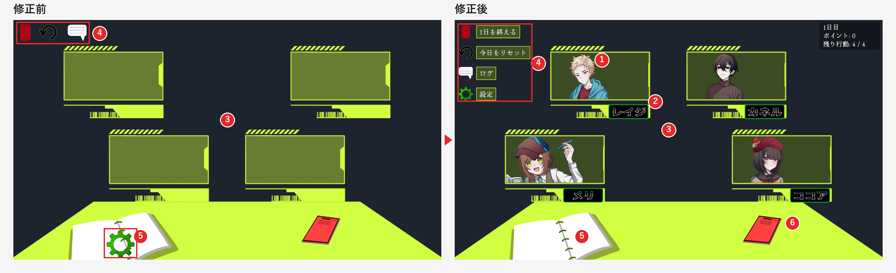
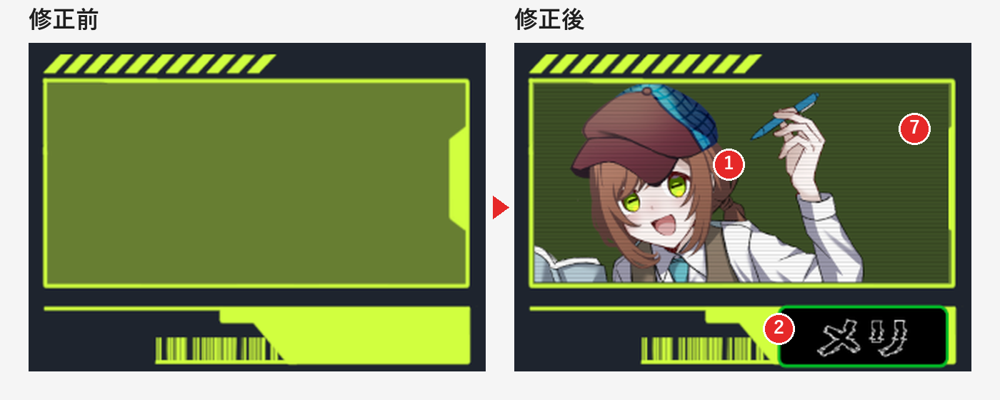
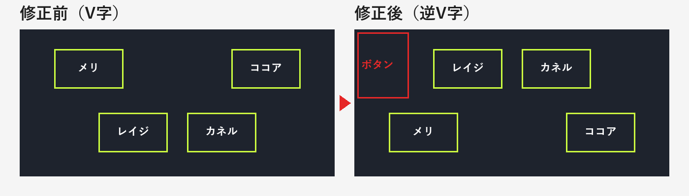
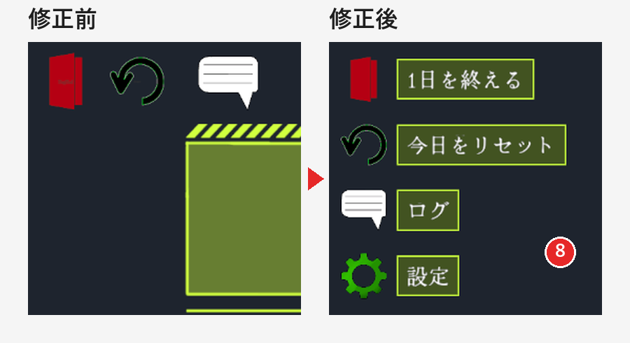
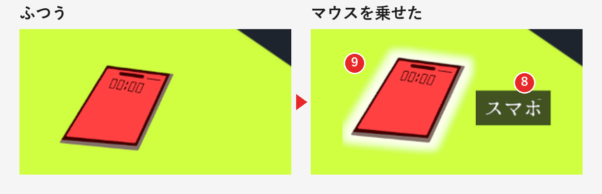
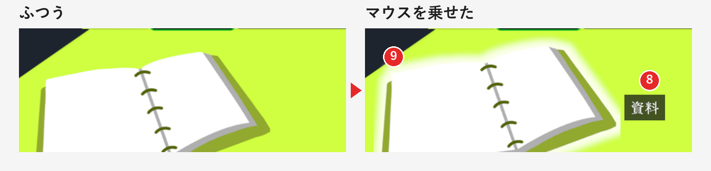
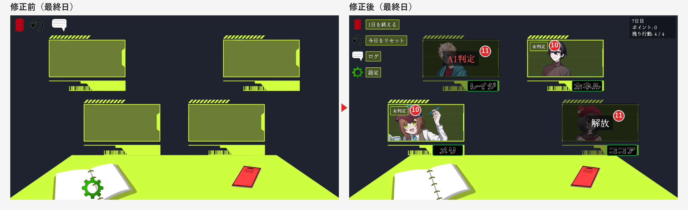

# モニター画面の変更点（デザイナーさんへ）

最終更新: 2026-10-17

初めて遊ぶ人にも操作が分かるように、モニター画面のレイアウトを変えました。何をどう変えたかと、デザイナーさんに見てほしいところをまとめています。
画像はすべて実際のゲーム画面です。クリックすると大きく見られます。

- 変えた理由: 遊んでもらうと、「どの部屋にだれがいるか分からない」「左上のアイコンが何のボタンか分からない」「机の歯車とノートが1つの物に見える」という声が出そうだったため
- 今回足した見た目の一部は**仮の見た目**です（4章）。差し替えをお願いしたいです

---

## 1. 全体の比較

| 番号 | 変えたこと |
|---|---|
| ① | 4つのモニターに、その部屋のキャラの顔を映した |
| ② | モニターの台の右側に、キャラの名前プレートを置いた |
| ③ | モニターの並びを「V字」から「逆V字」に変えた |
| ④ | 左上のアイコンを横並びから縦並びにして、右に文字を付けた |
| ⑤ | ノートの上にあった設定（歯車）を、④の並びに移した |
| ⑥ | スマホとノートに、マウスを乗せたときの反応を付けた |

※ 右上の「1日目 / ポイント / 残り行動」は、この前の変更で付けたものです。

---

## 2. モニターに顔と名前（①②）

- ① **顔**: 取調室で使っている立ち絵の、上のほう（顔から胸くらいまで）をモニターの画面の中に見せています。キャラごとに位置と大きさを合わせました
- ② **名前プレート**: 今ある名前プレートの画像を、台の右側に置きました
- ⑦ **画面の背景（暗い緑）と横線**: 顔が見やすいように、画面の中を暗い緑にして、モニターらしく細い横線を重ねました。**仮の見た目**です（4章）
- 解放・判定した部屋のモニターを暗くする表示は、今までと同じです

---

## 3. モニターの並びと左上のボタン（③④⑤）

### ③ モニターの並び

- 上の段の2つを真ん中に寄せ、下の段の2つを外側に広げました（逆V字）
- 空いた左上に、ボタンを縦に並べるためです
- **だれをどの位置に置くかは仮**です（今は上: レイジ・カネル、下: メリ・ココア）

### ④⑤ 左上のボタン

- アイコンを縦に4つ並べ、右に文字をいつも出しています: 「1日を終える」「今日をリセット」「ログ」「設定」
  - マウスを乗せなくても、何のボタンか分かるようにするため
- ⑤ 設定（歯車）はノートの上から、この並びの一番下に移しました（ノートと1つの物に見えていたため）
- アイコンの絵は今のままです。大きさだけ、4つの見た目の大きさがそろうように合わせました
- ⑧ **文字の札**（黒い四角に黄緑の線）は**仮の見た目**です（4章）

---

## 4. スマホとノート（⑥）

- マウスを乗せると、少し持ち上がってふちが光り、「スマホ」「資料」と名前が出ます
  - 「机の上の物は、乗せると反応する（押せる）」と気づいてもらうため
  - 「！」などの印は出しません（見るかどうかは、遊ぶ人に決めてもらいたいため）
- 名前の札（⑧）は、左上のボタンの文字の札と同じ見た目です
- 光り方（⑨）など、**マウスを乗せたときの見た目はこちらで調整します**

---

## 4-2. 最終日のモニター（⑩⑪）

最終日（7日目）は、4人全員を「AI か人間か」判定する日です。1日目と同じ見た目で、最終日だと伝わらなかったので変えました。

- ⑩ まだ判定していない部屋の左上に「**未判定**」と出します
- ⑪ 判定した部屋は、今までどおり暗くして、真ん中に「**AI判定**」（赤い字）か「**解放**」（白い字）を出します
- 札は、左上のボタンの文字の札（⑧）と同じ**仮の見た目**です
- 最終日になったことは、7日目の始めに補助ちゃんがスマホで説明します（画面に大きな文字は出しません）

---

## 5. 見てほしいこと・お願いしたいこと

### 確認してほしいこと

1. モニターの並び（逆V字）と、だれをどの位置に置くか
2. 左上のボタンの並び方（縦に4つ、右に文字）
3. 画面全体のバランスで、気になるところがあれば教えてください

### 仮の見た目（差し替えをお願いしたいもの）

| 番号 | 部品 | お願いしたいこと |
|---|---|---|
| ⑦ | モニターの画面の背景（今は暗い緑＋細い横線） | 色や模様を決めてほしい。顔が見やすい暗めの色だと助かります。素材を作ってもらう場合は、モニターの枠の内側に入る大きさ（横長の四角）でお願いします |
| ⑧⑩⑪ | 文字の札（左上のボタンの文字、「スマホ」「資料」の名前、最終日の「未判定」「AI判定」「解放」） | 札の外枠を**1種類だけ**作ってほしい。文字の長さが札ごとに違うので、**伸び縮みできる外枠**（四隅はそのまま、辺と真ん中だけ伸ばす作り）にしてください。**文字は描き込まず**、ゲームの中でフォントを使って出します |

- ⑧ の文字の**フォント**と**色**（札の線・中の塗り・文字）も決めてほしいです。最終日の「AI判定」は赤、「解放」は白で目立たせたいです
- 伸び縮みできる外枠の作り方は、`Docs/資料画面のデザイン相談.md` の 5-0 章と同じです（同じ作りにしてもらえると、資料画面と見た目をそろえられます）

### 変えていないもの

- モニター・机・ノート・スマホ・左上のアイコンの絵
- 名前プレートと立ち絵の画像

わからないことがあれば、いつでも聞いてください。
