# 操作の分かりやすさ 改善案

最終更新: 2026-10-17

初めて遊ぶ人が、説明を読まなくても操作が分かるようにするための改善案です。
ゲームの主な画面をスクリーンショットで撮り、初めて遊ぶ人の目線で「分かりにくそうな所」を洗い出しました。
どれをやるかは、チーム（特にデザイナーさん）と相談して決めます。決まったものは、この文書の「4. 決まった見せ方」と `Docs/仕様書.md` の17番に書きます。

---

## 1. 方針

- **最初に説明を読ませる方法（チュートリアル・補助ちゃんの解説）には頼らない**
  - 先生からの指摘: 説明は読み飛ばされやすく、読んでも覚えていられない。画面を見れば直感的に分かるようにしたほうがよい
- 画面そのものが、次の4つを伝えるようにする
  1. **何が押せるか**（押せる物が押せそうに見える）
  2. **次に何をすればいいか**（今やるべきことが目立つ）
  3. **押したら何が起きたか**（結果がすぐ見える）
  4. **なぜできないか**（できないときに理由が分かる）
- 説明が必要なときは、**必要になったその瞬間に、画面の変化や短い一言で知らせる**（長い説明はしない）

---

## 2. 見つかった問題

調べた画面: タイトル / モニター / 取調室 / 会話中 / 友人について / 資料 / スマホ / オプション / ログ / 1日終了の確認 / リザルト / 最終日のモニター / 最終日の取調室

### 🔴 最優先（これがないと遊び方が分からない）

| No. | 問題 | 画面 | 改善案 |
|---|---|---|---|
| U1 | **日数・ポイント・残りの行動回数が、どこにも表示されていない**。「1日4回」「7日間」というゲームの基本ルールが伝わらない | すべて | 表示する部分（`Header`）は作ってあるが、InGame シーンで非表示になっている。**表示をオンにする**。行動回数は数字ではなく、4つのアイコンが使うたびに1つずつ消える形にするとさらに分かりやすい |
| U2 | **4つのモニターに、だれがいるか分からない**（緑の枠だけで、顔も名前もない）。どの部屋に入ればいいか、今日もう取り調べた部屋はどれか分からない | モニター | モニターに各キャラの顔と名前を映す。今日取り調べた部屋は暗くして「済」を付ける。まだの部屋はゆっくり光らせる |
| U3 | **モニター画面のボタンが何か分からない** ・左上の3つのアイコンに文字がなく、どれが「1日を終える」か分からない ・机の歯車（設定）がノート（資料）に重なっていて、1つの物に見える ・スマホが「00:00」と出ているだけで、補助ちゃんと話せることに気づきにくい | モニター | アイコンに短い文字を付ける（例:「1日を終える」「やり直す」「ログ」）。歯車をノートから離す。スマホに、まだ聞いていない連絡があるときの通知の印を出す |
| U4 | **最終日であることが伝わらない**。7日目のモニターは1日目と同じ見た目。取調室のボタンが「解放」「AI（確定）」に変わるが、「今日は4人全員を判定する」という説明がない | 最終日のモニター・取調室 | 最終日の最初に「最終日：AIを見極めよ」と大きく出す。判定していない人の部屋を目立たせ、残り人数を出す |

### 🟡 大事

| No. | 問題 | 画面 | 改善案 |
|---|---|---|---|
| U5 | **行動の結果が分からない**。「対話」を選んでも会話が流れるだけで、ポイントや好感度が変わったことが見えない。どの行動が正解だったか学べない | 取調室 | 行動のすぐあとに「+20pt」「好感度↑」を一瞬大きく表示する |
| U6 | **取り調べたあと、ボタンが灰色になるだけ**で理由が出ない。壊れたように見える | 取調室 | 「今日はもう取り調べました」と表示する |
| U7 | **資料の解禁方法が分からない**。「？」の枠に、何ポイントで解禁できるか・どう押せばいいかが出ていない。この画面に今のポイントも出ていない。見出しの「作業方法」の意味が分からない | 資料 | 「？」の枠に「30pt で解禁」と出す。今のポイントを表示する。解禁できるポイントが貯まったら、モニターの資料ボタンに「！」を付ける。見出しを見直す |
| U8 | **会話中に「クリックで次へ」の印がない** | 取調室・スマホ | 文の最後に「▼」を出す |
| U9 | **拷問・対話・交渉の違いが分からない** | 取調室 | マウスを乗せたら一言の説明を出す（例:「対話：穏やかに話を聞く」） |

### 🟢 見た目の問題（あとでまとめて直す）

| No. | 問題 | 画面 |
|---|---|---|
| U10 | 「獲得ポイント: +200 pt」が2行に折り返して、「【本日の取り調べログ】」と重なっている。見出しが英語（「Selected AI Data」「DAILY REPORT」） | リザルト |
| U11 | 「だれについて聞く？」のような見出しがない。ボタンは **「マキナ」** なのに、資料では同じキャラが **「メリ」**（どちらかの名前の間違い？） | 友人について |
| U12 | 「補助ちゃん」の名前が本文と重なっている | ログ |
| U13 | 「セーブ」「ロード」のボタンがほかの項目と重なっている（PR #34 で分かっている件） | オプション |
| U14 | 選択肢の画面がつぶれて表示される（PR #30 で分かっている件） | 選択肢 |
| U15 | 「つづきから」「エンディング一覧」のボタンが、スタートボタンと見た目がそろっていない（コードで作った仮の見た目） | タイトル |

---

## 3. 対応状況（2026-10-17）

| No. | 状態 |
|---|---|
| U1 日数・ポイント・残り行動 | **対応済み**（PR #37。右上に表示。行動は残りの回数「残り行動: 3 / 4」） |
| U2 モニターにだれがいるか | **対応済み**（PR #40。4つのモニターに顔と名前プレートを出した。画面の背景色と横線は仮の見た目） |
| U3 モニター画面のボタン | **対応済み**（PR #41。モニターを逆V字に並べ、左上のアイコンに文字を付けた。スマホとノートは乗せると反応する。札と光は仮の見た目。モニターの並びはデザイナーさんに確認する） |
| U4 最終日 | **ほぼ対応済み**（PR #42。最終日のモニターの札と、朝の会話の仕組み・7日目の説明（仮の文）。取調室のボタン名はデザイナーさんの画像なので相談中） |
| U5〜U9 | **見せ方が決まった**（4章）。まだ作っていない |
| U10 リザルト | 重なりは**対応済み**（PR #38）。英語の見出し（「Selected AI Data」「DAILY REPORT」）はまだ |
| U11 マキナとメリ | 調べて分かった（4章）。直すのはあとで |
| U12 ログ・U13 オプション・U14 選択肢 | **対応済み**（PR #38） |
| U15 タイトルのボタン | まだ |

## 3-2. おすすめの進め方

1. **U1（日数・ポイント・行動回数の表示）と U2（モニターにだれがいるか）から直す**。この2つだけでも、初めて遊ぶ人にとってかなり分かりやすくなる。U1 はもとからある表示をオンにするだけなので、すぐにできる
2. ボタンの位置や見た目はデザインに関わるので、このリストをデザイナーさんに見せて相談する
3. 直したら、**初めて遊ぶ人に何も説明せずに遊んでもらう**（3〜5人で十分）
   - 遊んでいる間は口を出さず、手が止まった所・迷った所・間違えた所をメモする
   - 「今何をしようとしてる？」と、思っていることを口に出しながら遊んでもらうと、さらに分かる
   - 何人もが同じ所で止まるなら、そこを直す

---

## 4. 決まった見せ方

話し合って決まった見せ方を、問題の番号ごとに書きます。イメージ画像は、今のスクリーンショットに素材を重ねて作ったもので、実際のゲーム画面ではありません。

### U2 モニターにだれがいるか（2026-10-16 決定）

- 4つのモニターに、それぞれ **キャラの顔（上半身）** と **名前プレート** を出す
  - 顔: 取調室で使っている画像（ProfileData の `characterIcon`。全身の立ち絵なので、上のほうだけを見せる）。キャラごとに見せる位置と大きさを調整する
  - 名前プレート: もとからある画像（`Image/CharacterUI/Game_Charactername_*.png`）を、モニターの下の台の右側に置く
- **今日の状態（まだ・取り調べ済み）は出さない**。解放した・判定した部屋を暗くする今の表示はそのまま残す
- **好感度は出さない**（ゲームの設計に関わるので、出すならチームで決めてから）
- 背景の色や横線などの見た目は**仮で作り**、あとでデザイナーさんに差し替えてもらう
- 作る手間: 2〜3時間
- 見送った案: 取り調べ済みの部屋を暗くして「済」と今日の行動を出す、まだの部屋を光らせる（あとから足すこともできる）
- **作った（PR #40）**: 顔・名前プレート・画面の背景は、モニターのボタン（`SelectRoom◯_Button`）の中に置いたので、U3 でモニターを動かせば一緒に動く。顔の位置と大きさは、`InGame.prefab` の `Screen/Face` で部屋ごとに調整できる。仮の見た目（画面の背景色 `Screen`、横線 `Scanline`）は、デザイナーさんの素材が来たら差し替える

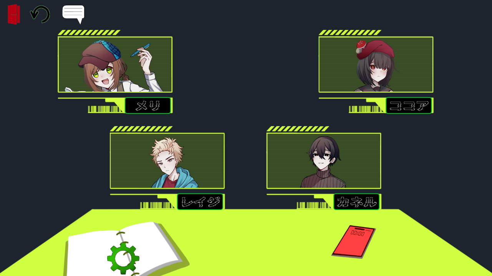

作ったあとのゲーム画面（1日目）

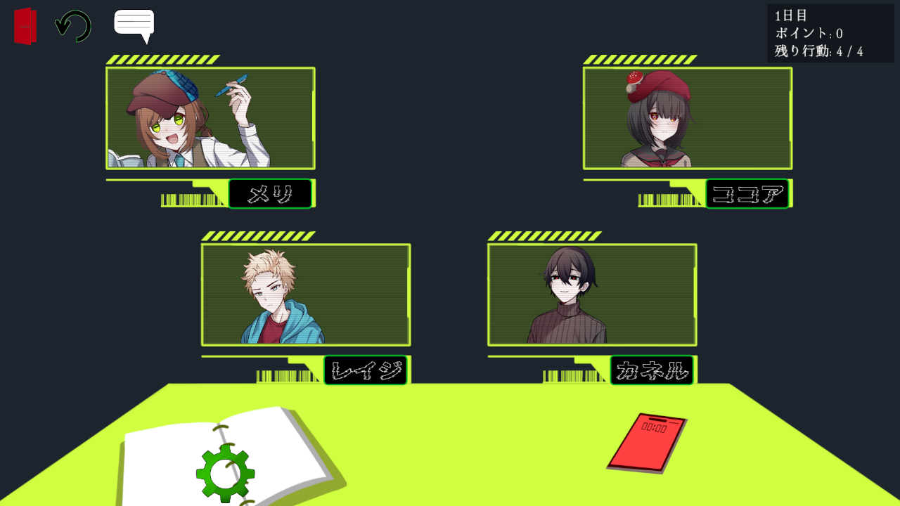

### U3 モニター画面のボタン（2026-10-16 決定）

- **モニターの並びを逆V字にする**。上の段の2つを真ん中に寄せ、下の段の2つを外側に広げる（だれをどの位置に置くかは未定。画像の並びは仮）
- 空いた左上に、アイコンを**縦に4つ**並べる: 「1日を終える」「今日をリセット」「ログ」「設定」
  - アイコンの右に**文字をいつも出しておく**（マウスを乗せなくても分かる）
  - 設定（歯車）はノートの上から、この並びに移す
- **スマホ**: マウスを乗せると、少し持ち上がってふちが光り、「スマホ」と文字が出る
  - 「！」の印や回数は出さない。**スマホを見るかどうかは、プレイヤーが自分で決める**ようにしたいため（見ないと損だと思わせない）
  - 机のノートにも同じ反応を付けて（乗せると「資料」と出る）、「机の上の物は乗せると反応する」ことを画面全体でそろえる
- 見た目（文字の枠、光り方）は仮で作り、あとでデザイナーさんに差し替えてもらう。モニターの配置が変わるので、デザイナーさんにも確認する
- 作る手間: 2〜3時間（モニターとアイコンの並べかえ1時間、スマホとノートの反応1〜2時間）
- 見送った案
  - 左上に横並びのまま、乗せたときだけ文字を出す → 文字が上のモニターに重なる
  - 上の真ん中の「▼」を押すと出てくる引き出しにしまう → 毎日押す「1日を終える」が隠れてしまう
  - スマホに「！」の印を出す → 見なければいけないと思わせてしまう

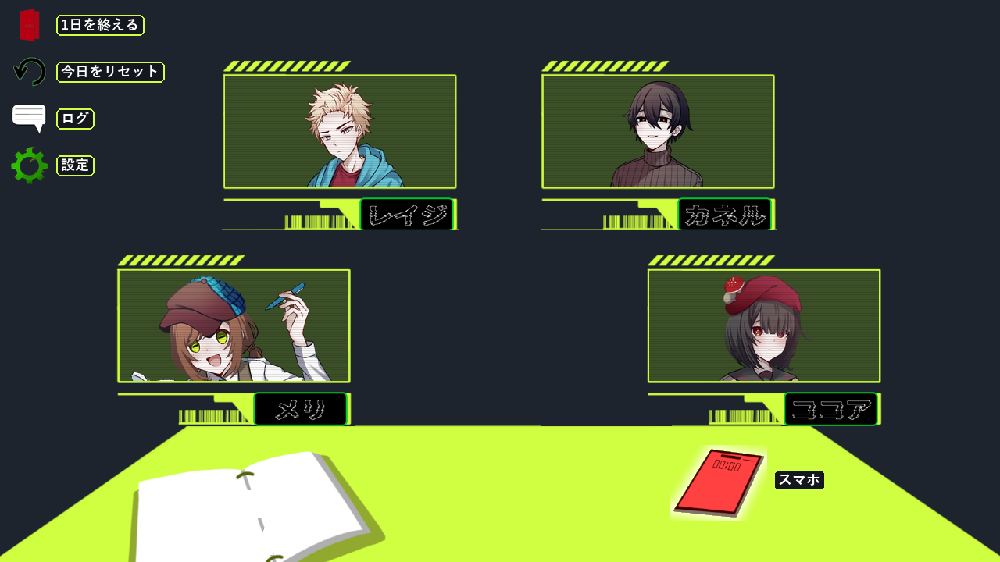

- **作った（PR #41）**
  - モニターの並びは、イメージ画像と同じ（上: レイジ・カネル、下: メリ・ココア）。並べかえは `InGame.prefab` の `MonitorGrid/MonitorRoom_◯` の位置を変えるだけでできる
  - 左上のアイコンは `MonitorPanel/SideMenu` にまとめた。文字の札（`Label`）はボタンの中にあるので、札を押してもボタンが押される
  - スマホとノートに乗せたときの反応は `HoverHighlightUI`。光は形に合わせた白いぼかし画像（`Image/Monitor/Monitor_Glow_*.png`）、札は `SmartphoneLabel`・`ProfileLabel`
  - 仮の見た目: 文字の札（黒い四角に黄緑の線）、光の画像。デザイナーさんの素材が来たら差し替える
  - デザイナーさんへの説明（U2・U3 の修正前と修正後）: `Docs/モニター画面の変更点_デザイナー向け.md`

作ったあとのゲーム画面（左: ふつう、右: 確認のため、スマホとノートの両方にマウスを乗せた状態）

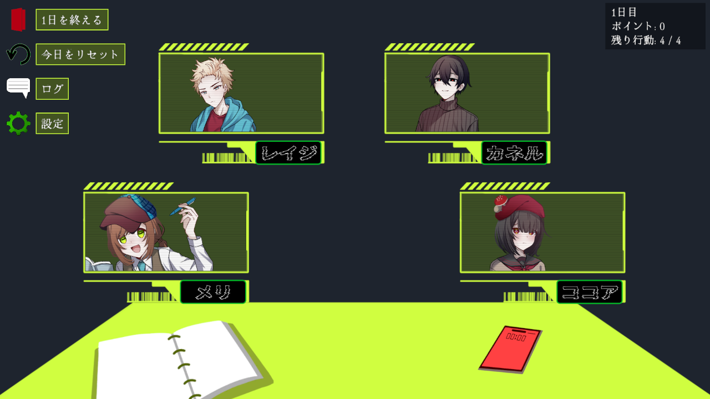 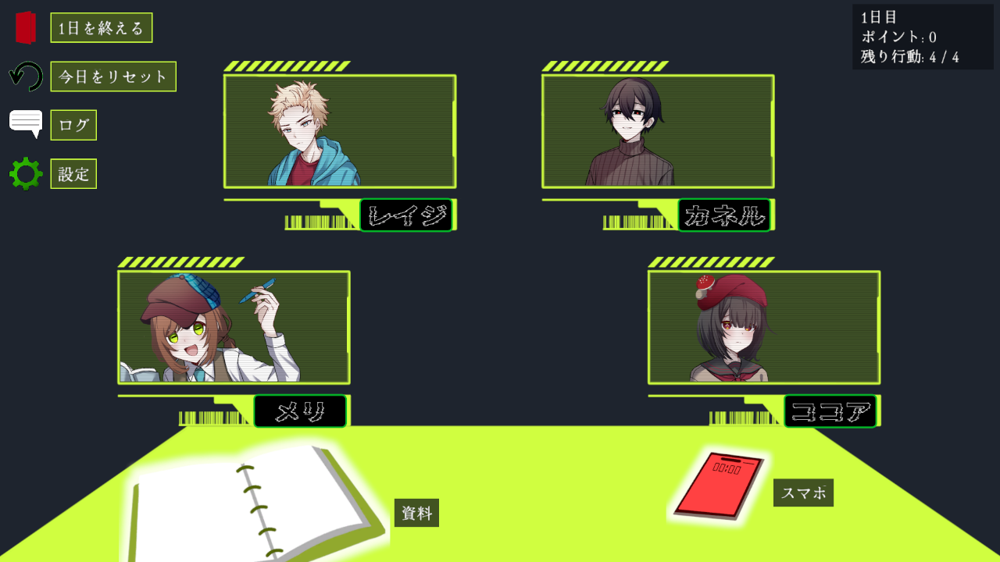

### U4 最終日であることが伝わらない（2026-10-16 決定）

- **最終日になったことは、マキナ（補助ちゃん）が説明する**。7日目の始めに、下の「朝の会話」の仕組みで自動で流す
- **最終日のモニター**: まだ判定していない部屋の左上に「未判定」と出す。判定した部屋は暗くして、「AI判定」（赤い字）か「解放」（白い字）と出す
  - U2 では「今日の状態は出さない」と決めたが、最終日は判定することがその日の目的なので、例外として出す
- **最終日の取調室**: ボタンの名前を「解放する」「AI と判定する」に変える（今は「解放」「AI（確定）」）。説明の文は出さない（マキナが説明するため）
- 見送った案: 日が変わる演出で「最終日」と大きく出す、モニターの上に「残り◯人」の帯を出す、まだの部屋を赤く光らせる（急かす感じになる）
- **作った（PR #42）**
  - 最終日のモニターの「未判定」「AI判定」「解放」の札。札の見た目は仮（左上のボタンの文字の札と同じ）
  - 7日目の始めに、朝の会話で補助ちゃんが最終日の説明をする（文は仮。シナリオ担当の人に書き直してもらう）
  - **まだ**: 取調室のボタンの名前（「解放する」「AI と判定する」）。今のボタンはデザイナーさんが文字ごと描いた画像なので、変えるかどうか相談中

作ったあとの最終日のモニター（レイジを AI判定、ココアを解放したところ）

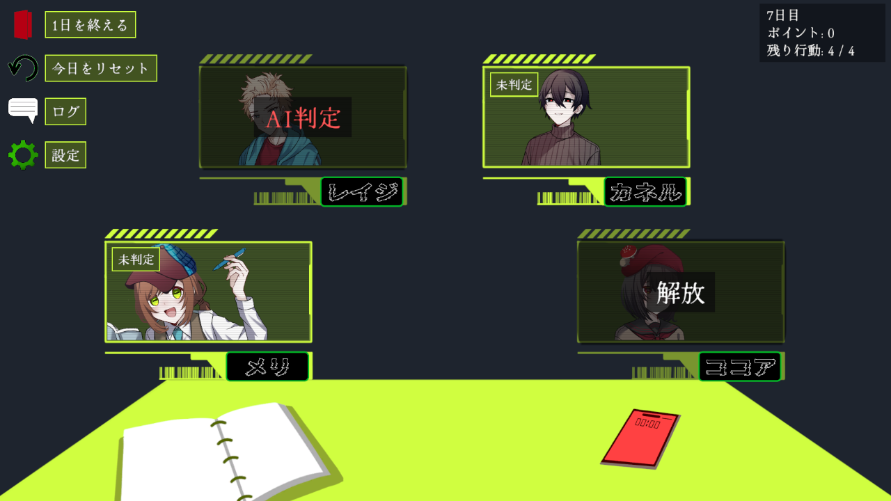

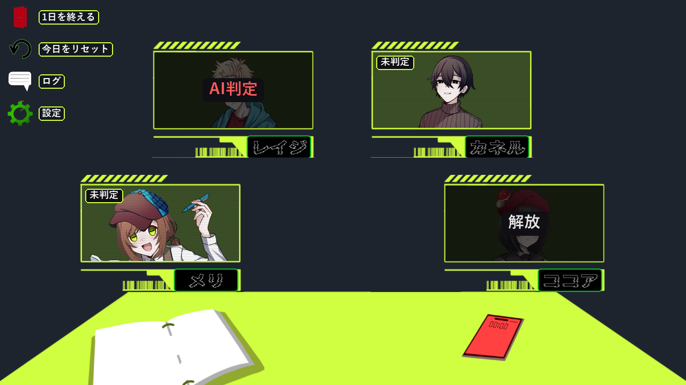

#### 朝の会話（どの日でも、日の始めに自動で流せる会話）

最終日だけでなく、**どの日にも、日の始めに自動で流れる会話を差し込めるようにする**。毎日入れるかは未定なので、入れたい日にだけ Excel に行を足せばよい形にする。

- **Excel の書き方**: 条件シートの「行動」に、新しく「**朝**」を足す。行があれば、その日の始めに自動で流れる。行がなければ何も起きない（コードを直さずに差し込める）

  | 日 | キャラ | 行動 | 優先度 | 必要フラグ | … | セリフID |
  |---|---|---|---|---|---|---|
  | 7 | | 朝 | 1 | | | MORNING_D7 |

  - ほかの行動と同じように、フラグや好感度の条件で出し分けられる
- **流れ**: 日が変わる演出 → **スマホの呼び出し音** → **スマホの会話画面が自動で開いて**会話が流れる → 会話が終わったら、**日が変わるときと同じ演出**でモニター画面に戻る（一瞬で切り替えない）
- スマホで話せる回数は減らない。会話はログに残り、既読ならスキップできる
- **「今日をリセット」やロードでその日の始めに戻ったときは、もう一度流さない**（聞き直したいときはログで読める）
- 必要な素材: **スマホの呼び出し音の効果音**（まだない）
- 作る手間: 半日くらい（Excel の取り込み、流す処理、テスト）
- **作った（PR #42）**
  - Excel: 条件シートの「行動」のプルダウンに「朝」を足した。説明シートに書き方の例を足した
  - 呼び出し音は、音の素材ができたら `Data/SE` に入れて、InGame の GameUIController の「Morning Ring Se Name」にファイル名を書けば鳴る（今は空なので鳴らない）
  - 朝の会話で手に入るフラグ・AI化は、「今日をリセット」しても消えない（朝の状態に入る）

 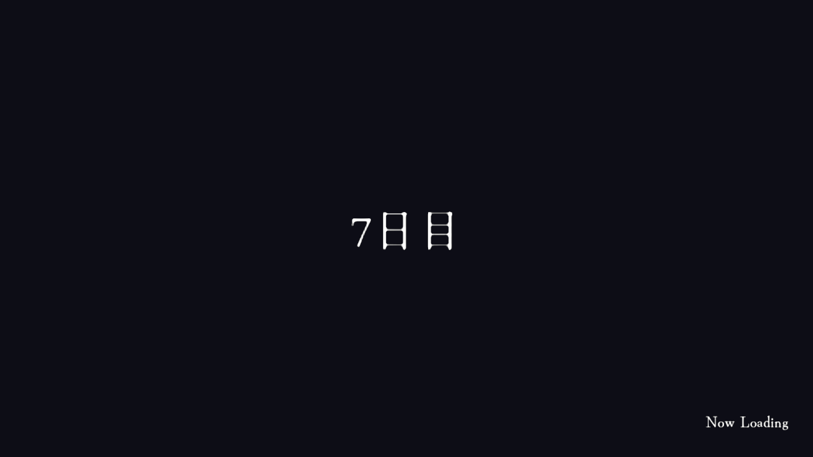

### U5 行動の結果が分からない（2026-10-16 決定）

- **ポイントははっきり見せる**。行動の会話が終わったら、「+20pt」のように短く（1.5秒ほど）出して消す
- **好感度は、数字も矢印も出さない**。好感度というステータスがあること自体をプレイヤーに隠し、いろいろなルートを自分で調べてもらうため
  - その代わり、**変化はキャラの反応で伝える**（立ち絵の表情・効果音・セリフの調子）
  - 表情の差分は4人ともそろっているので、新しい素材は要らない（笑顔と、つらそうな表情2つ。例: メリは恐怖・悲しみ、レイジは怒り・絶望）
- 未定
  - 反応の出し方: シナリオの本文シートで、セリフごとに表情を指定するだけにするか。それとも、好感度が上がった・下がったときに、自動で表情と効果音を出す仕組みも作るか
  - 日の終わりのリザルトに「ココア：対話 +20pt」のような振り返りを足すか（足す場合も、好感度は書かない）
- 見送った案: 「好感度 ↑」の矢印を出す（好感度があることが分かってしまう）
- 行動で入るポイントは0以上。入った分を「+◯pt」と出し、0のときは何も出さない
- 表情が変わるときに**効果音**を鳴らす（よい反応と悪い反応で音を変える）
- 立ち絵を少し揺らすなどの動きは、実際に動くものを見てから決める（未定）
- イメージ画像（左: 正解の行動をして、ポイントが入り、笑顔になった。右: 嫌がる行動をして、絶望の表情になった）
  - 画面の中の顔が小さいので、表情が変わっただけでは気づきにくい。効果音を付けるのはそのため

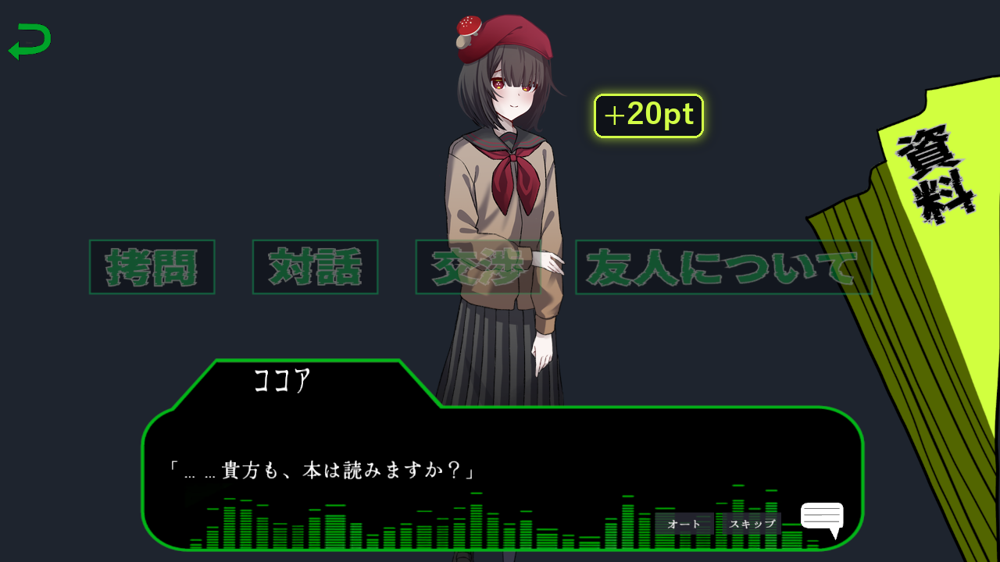 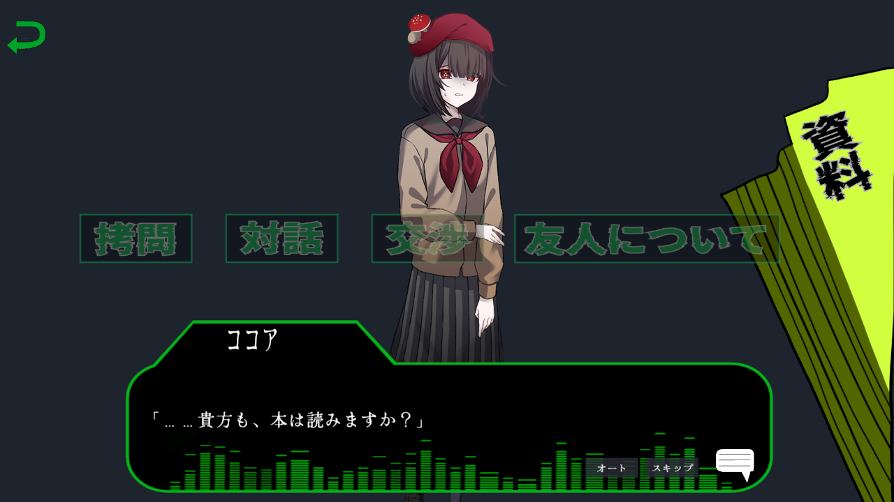

#### あとで話し合うこと：隠しステータス（好感度）で、ゲームが面白くなるか、つまらなくなるか

U5 を決めるときに出た話。どうすれば隠しステータスが「面白さ」になるかを、あとでチームで話し合う。

- 隠しステータスがあること自体は、ゲームをつまらなくしない。数字を見せない恋愛ゲームや RPG は多く、「何が効いたんだろう」と探るのは楽しさの一つになる
- **面白くなるとき（数字は隠す＋反応は見える）**: 「対話したら態度がやわらいだ」「拷問したら目をそらすようになった」と気づける。自分の選択が効いていると感じ、ほかの選び方も試したくなる
- **つまらなくなるとき（数字も反応も見えない）**: エンディングが変わっても理由が分からず、「運で決まった」「適当に選んでも同じ」と感じる
- **ゲームジャムで気をつけること**: 審査する人や遊ぶ人は1回しか遊ばないことが多い。1回の中で「選び方で反応が変わる」と気づけないと、複数のルートがあることも伝わらない
- 気づいてもらうための手段
  - キャラの反応（立ち絵の表情・効果音・セリフの調子）
  - 好感度で変わるセリフ（条件シートの「本人の好感度」で、仲がよくなったときだけ出るセリフが作れる。仕組みはもうある）
  - エンディング一覧の「？？？」（見ていないエンディングがあると分かれば、別のルートがあると伝わる）
- 話し合いたいこと
  - 1回遊んだだけで、反応の違いに気づけるだけの量のセリフや表情を用意できるか
  - 好感度で変わるセリフを、どの日・どのキャラに入れるか

### U6 取り調べたあと、ボタンが灰色になるだけ（2026-10-16 決定）

- 取り調べたあとは、**行動のボタン（拷問・対話・交渉・友人について）を消して**、その場所に「**今日はもう取り調べました**」と出す
- 文はこの1つだけでよい。1人に1日1回しか取り調べできず、1日の行動回数（4回）とキャラの人数（4人）が同じなので、行動回数を使い切ったときは4人とも取り調べ済みになっているため
  - 注意: 1日の行動回数は Unity の設定（InterrogationManager）で変えられる。4回より少なくする場合は、文を見直す
- 見送った案: ボタンの上に理由を出しておく（灰色のボタンは残る）、灰色のボタンを押したときだけ理由を出す（押さない人には伝わらない）

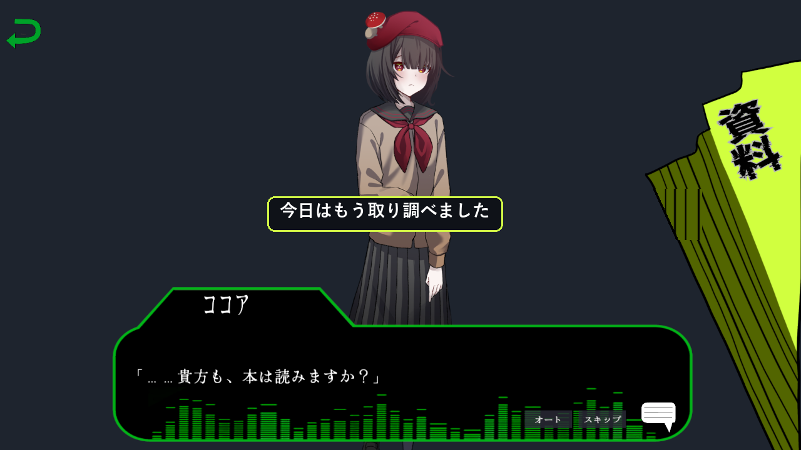

### U7 資料の解禁方法が分からない（2026-10-16 決定）

- 調べて分かったこと: 今は、**ポイントが足りないときに「？」を押しても何も起きない**（確認も理由も出ない）。足りるときは「30pt を使って『〇〇』を解禁しますか？」と確認が出る
- **「？」の枠の見た目を、ポイントが足りるかどうかで変える**
  - 足りるとき: 明るくして、「**20pt で解禁**」のボタンを出す（押すと今の確認が出る）
  - 足りないとき: 暗くして、「**50pt 必要（あと 10pt）**」と出す
  - 必要なポイントは ProfileData にもう入っている（ココアの基礎情報は 20pt、ほかは 30〜70pt）
- **この画面に今のポイントを出す**（例: 名前の横に「所持 40pt」）。U1 のポイントの表示と見た目をそろえる
- **見出しの「作業方法」**: デザイナーさんとの連絡の行き違いで入った文。消したいが、デザイナーさんが作ったデザインなので、**AI は触らずにデザイナーさんに任せる**
- **モニターの資料ボタンに「！」は付けない**（U3 のスマホと同じく、見なければいけないと思わせないため）
- あとで話し合うこと: **資料に載せたい情報の量に対して、レイアウトが狭くて載せきれない**。デザイナーさん向けに `Docs/資料画面のデザイン相談.md`、プログラム側で作る動きを `Docs/資料画面の動き_プログラム側.md` にまとめた。キャラの切り替えを画面の上のタブにする方向で、デザイナーさんに相談する（2026-10-17）
- イメージ画像: 今 40pt 持っていて、上の「？」（基礎情報 20pt）は解禁でき、下の「？」（過去の情報 50pt）はまだ足りない場面

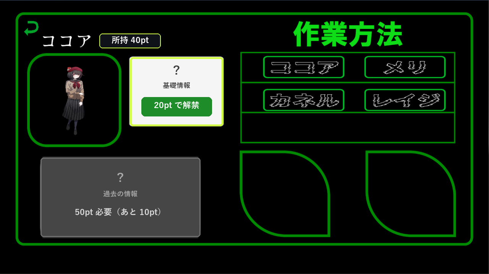

### U8 会話中に「クリックで次へ」の印がない（2026-10-17 決定）

- 文字が全部出終わったら、**文の最後のすぐ後ろ**に緑の「▼」を出す（読み終えた所に目があるので気づきやすい）
- **オートで進んでいるときも出す**（いつも同じ見た目にする）
- **取調室の会話とスマホの会話の両方**に付ける。スマホの会話画面（DialogueClickable）はチームの人が作った画面なので、触るときは作った人に一言伝える
- **点滅させる**（2026-10-17 決定）
- 見送った案: 会話の枠の右下に出す（文が短いと目から遠い）

### U9 拷問・対話・交渉の違いが分からない（2026-10-17 決定）

- **1日目の始めに、マキナが3つの行動の違いを短く説明する**。U4 の「朝の会話」の仕組みを使う（条件シートに 1日目の「朝」の行を足すだけ）
  - 「説明を読ませる方法には頼らない」方針があるので、**3〜4行くらいに短く**し、お話の一部として聞こえるようにする
  - 好感度があることは隠すので、数字や「好感度」という言葉は使わない
- **行動を選んだら、会話の最初の1文で、どんな行動かを伝える**（例: 対話「あなたは椅子を引き寄せ、静かに話しかけた。」）。もともと入れる予定だった。シナリオの本文シートで書く
- 見送った案: マウスを乗せたら説明を出す、ボタンの下にいつも説明を出す（説明のポップアップは画面の邪魔になる）、ボタンに絵を付ける、ボタンの名前を変える

### U11 名前「マキナ」と「メリ」（調べて分かったこと。対応はあとで決める）

- 「友人について」のボタンの「マキナ」は文字ではなく画像（`Game_Charactername_MakinaAI.png`）。**マキナは補助ちゃんの名前**なので、メリのボタンに補助ちゃんのプレートが貼られている間違い。`Game_Charactername_Meri.png` に差し替えれば直る
- 補助ちゃんの名前を、ゲームの中で「マキナ」と出すかどうかは未定（今は Excel の本文シートで、話す人の名前が「補助ちゃん」になっている）

---

## 5. 画面ごとのスクリーンショット

2026-10-15 に撮影（1日目、ココアと対話したあと）。画像の下に、その画面に関係する問題の番号を書いています。

### タイトル
関係する問題: U15（「つづきから」「エンディング一覧」の見た目がスタートとそろっていない）

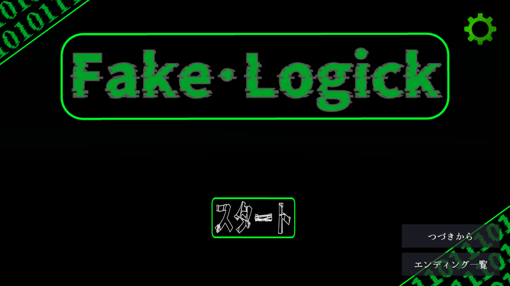

### モニター画面
関係する問題: **U1**（日数・ポイント・行動回数がない）、**U2**（モニターにだれがいるか分からない）、**U3**（左上のアイコンに文字がない、歯車がノートに重なっている、スマホに通知がない）

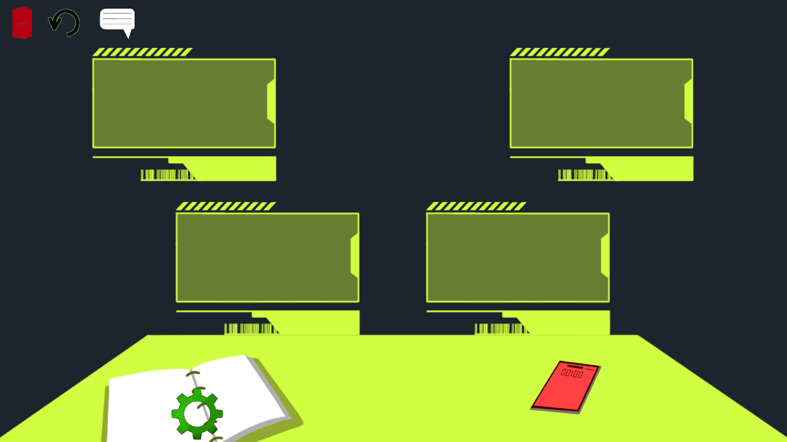

### 取調室
関係する問題: **U1**（ポイント・残りの行動回数がない）、U9（拷問・対話・交渉の違いが分からない）

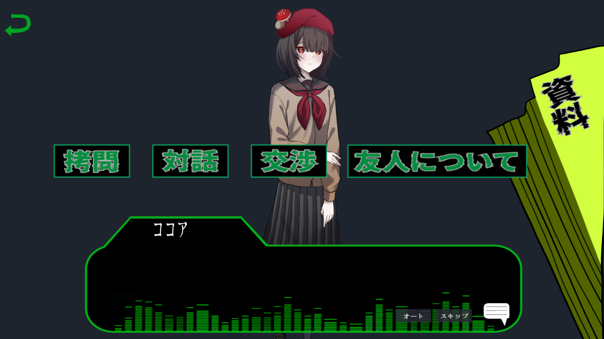

### 会話中
関係する問題: U8（「クリックで次へ」の印がない）

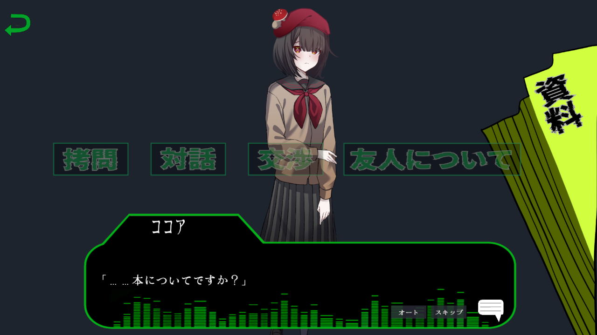

### 会話のあと
関係する問題: **U5**（ポイント・好感度が変わったことが見えない）、**U6**（ボタンが灰色になるだけで理由が出ない）

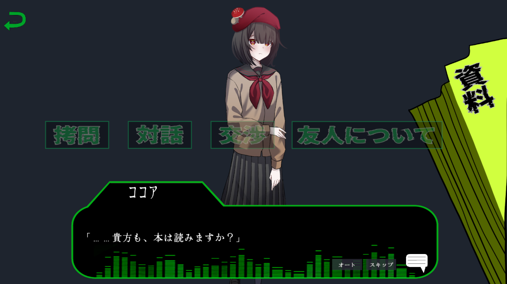

### 友人について
関係する問題: U11（見出しがない。「マキナ」と資料の「メリ」で名前が違う）

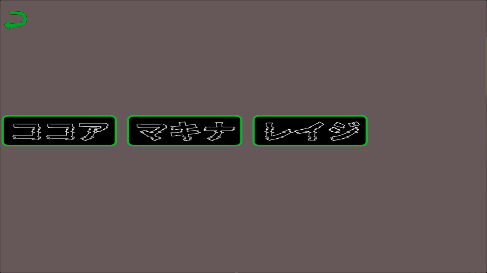

### 資料
関係する問題: **U7**（「？」の解禁方法・必要なポイントが分からない。今のポイントがない。見出しが「作業方法」）

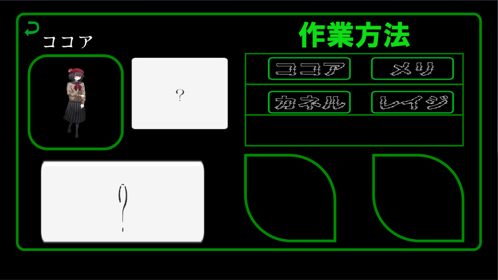

### スマホ（補助ちゃん）
関係する問題: U8（「クリックで次へ」の印がない）。セリフはまだ仮の文

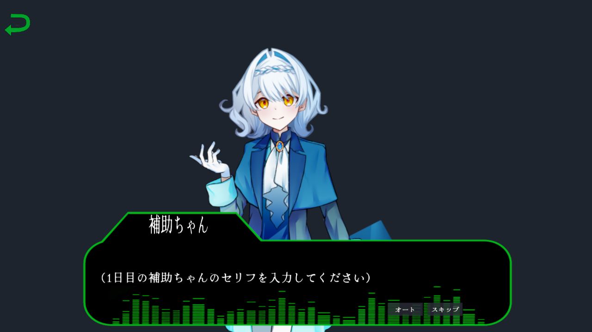

### オプション（ゲーム中）
関係する問題: U13（「セーブ」「ロード」がスキップの行と重なっている）

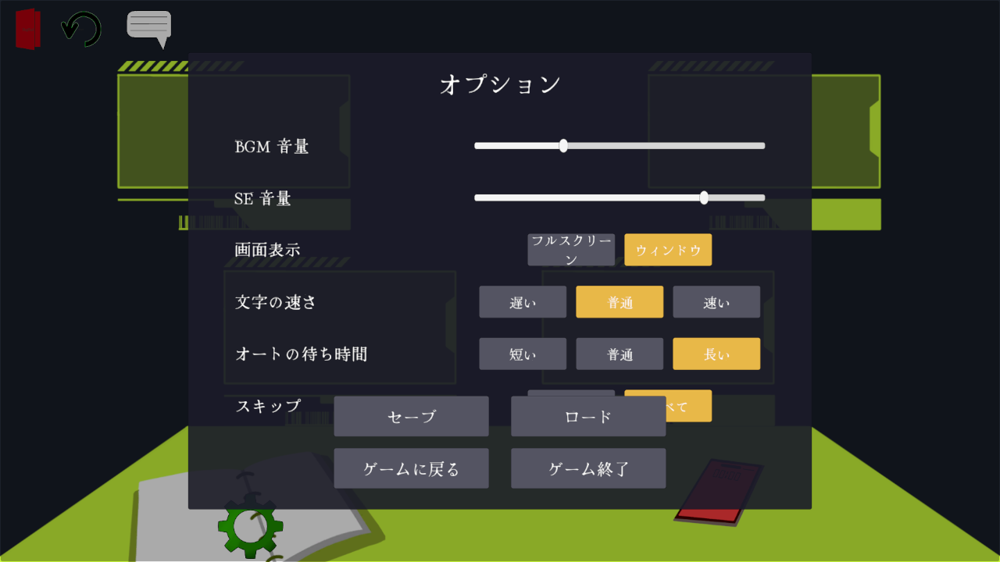

### ログ
関係する問題: U12（「補助ちゃん」の名前が本文と重なっている）

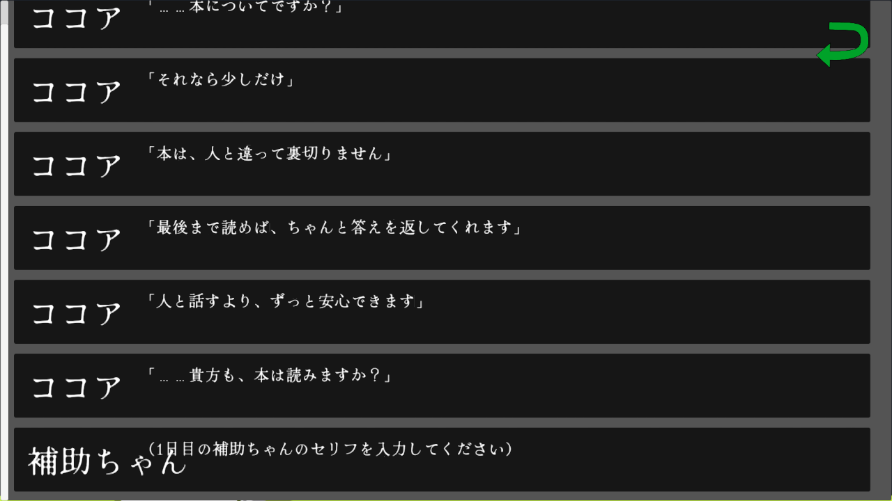

### 1日終了の確認
問題なし（分かりやすい）

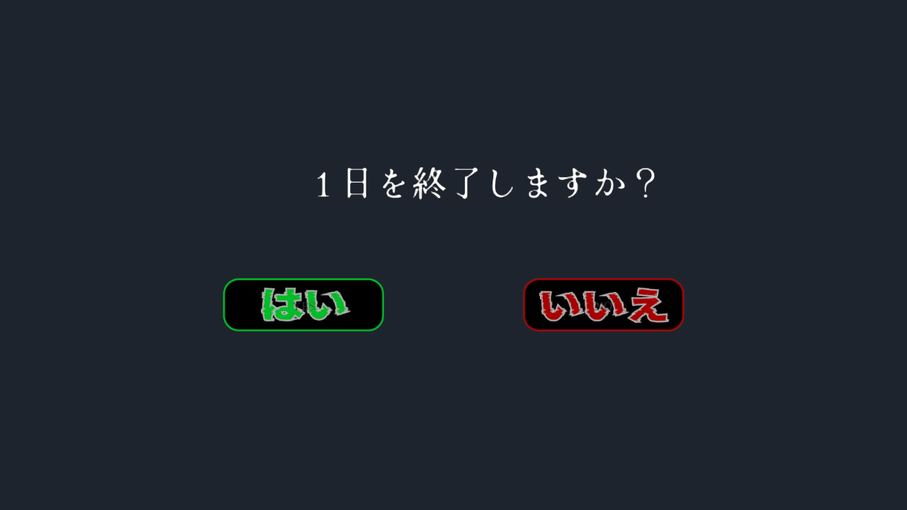

### リザルト
関係する問題: U10（「獲得ポイント」が折り返して下の行と重なっている。見出しが英語）

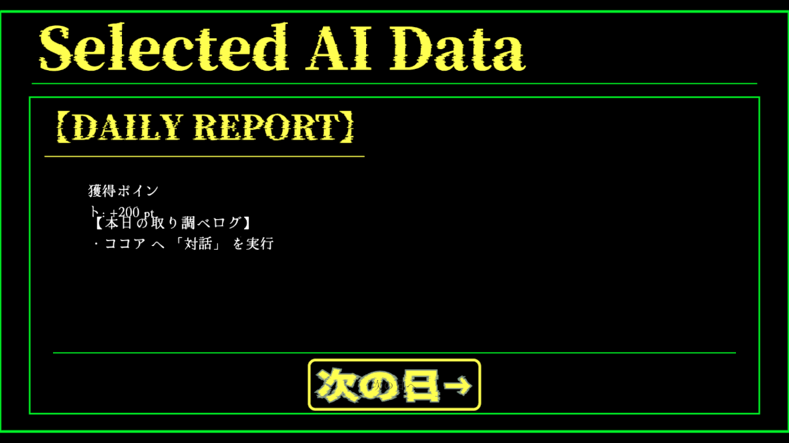

### 最終日のモニター画面
関係する問題: **U4**（1日目とまったく同じ見た目で、最終日だと分からない）

### 最終日の取調室
関係する問題: **U4**（「4人全員を判定する日」という説明がない）

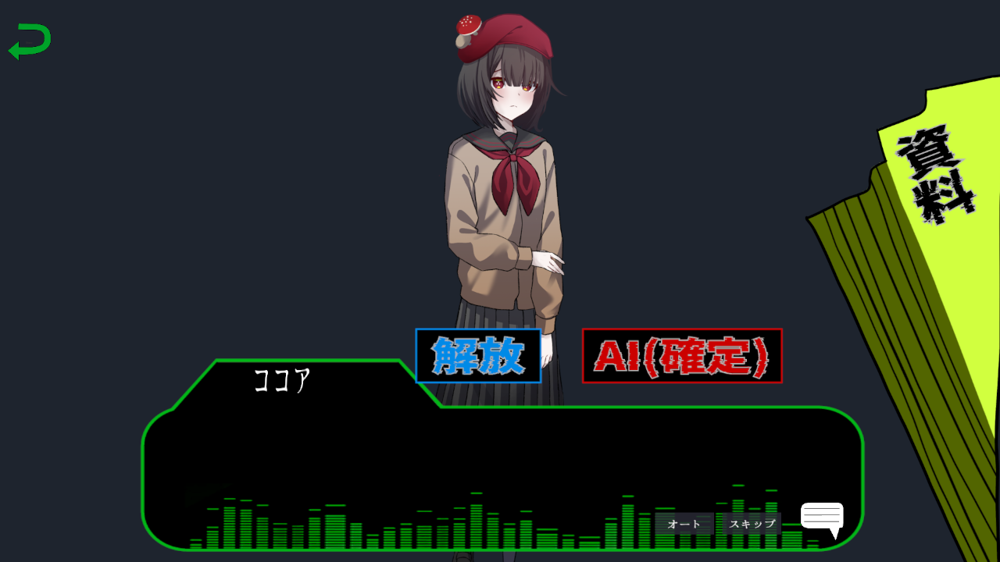

---

## 6. スクリーンショットの撮り方（AI 向けのメモ）

Unity を開いた状態で、Unity CLI を使って撮れます（Claude Code に頼めば撮影できます）。
画面を開く → `unity command capture_game_view --save_path <Assets 内の場所>` で Game ビューを撮る。
撮った画像は Assets の中に保存されるので、`Docs/images/` に移して、Assets の中のものは消す（Unity の素材として読み込ませないため）。
