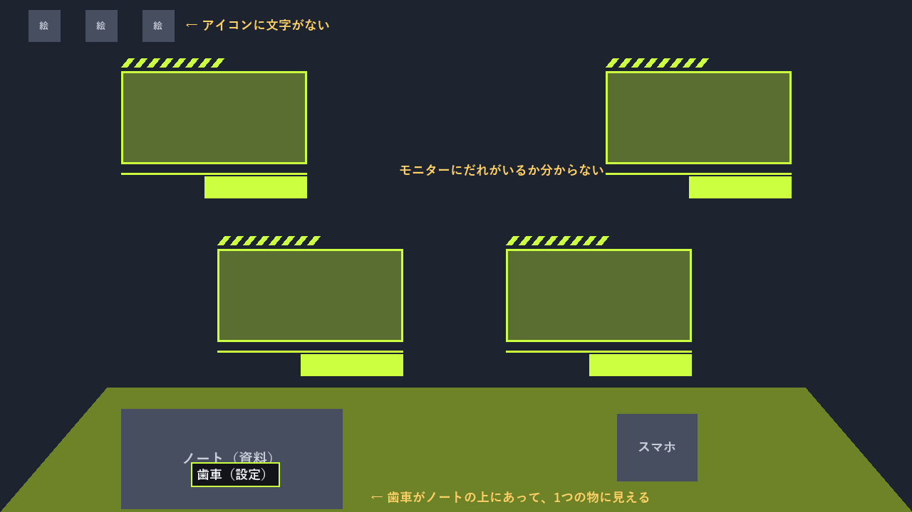
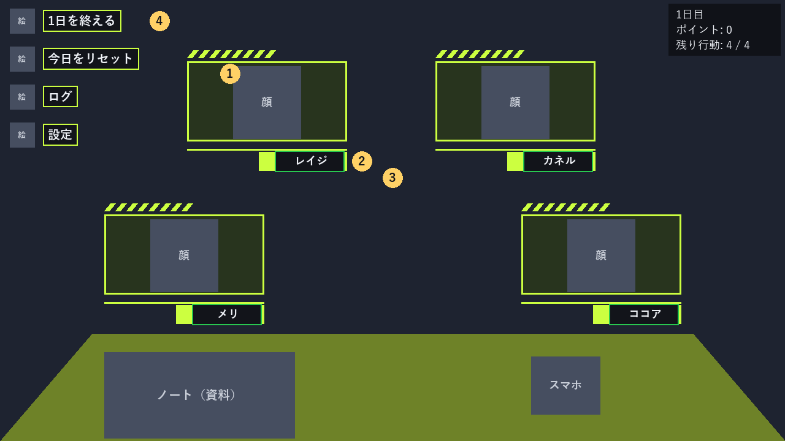
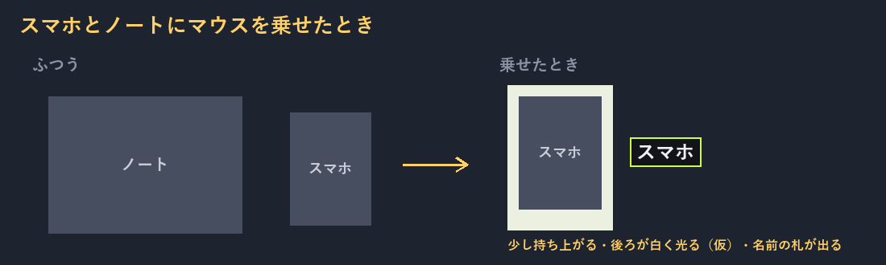
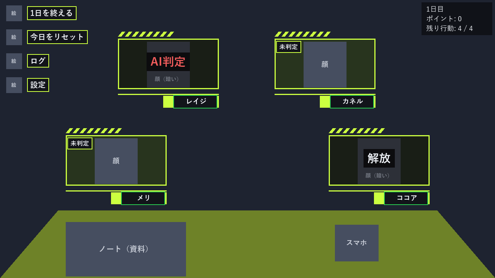
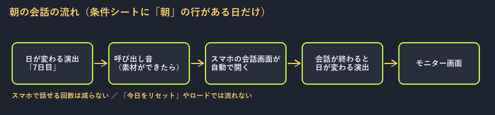
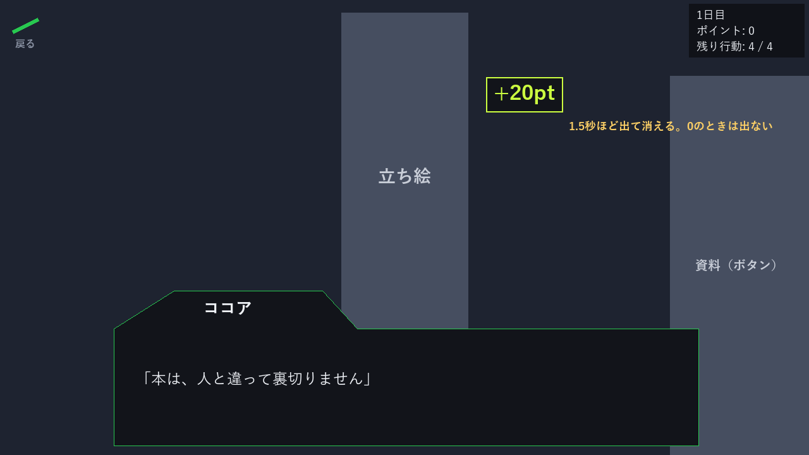
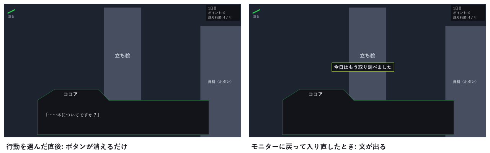
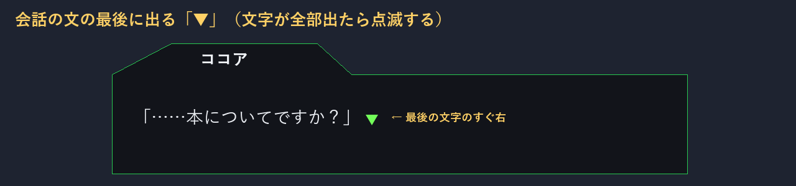

# 見た目の変更まとめ（改善案 U1〜U8）

最終更新: 2026-10-19

「初めてでも操作が分かる画面」（`Docs/操作の分かりやすさ_改善案.md`）で変えた見た目を、画面ごとにまとめました。

- 図は**四角と文字だけ**で描いたものです。立ち絵・顔・ボタンの絵などがある場所は、何の絵かを書いた灰色の四角にしています（デザイナーさんの指示で、絵を AI に読み込ませない・作らないため）
- 実際の見た目は Unity で見てください
- 図を作るスクリプト: `Docs/tools/make_wireframes.py`（`python Docs/tools/make_wireframes.py` で `Docs/images/wire/` に作り直せる）

| No. | 変えたこと | PR |
|---|---|---|
| U1 | 右上に日数・ポイント・残り行動を出した | #37 |
| U2 | モニターにキャラの顔と名前プレートを映した | #40 |
| U3 | モニターを逆V字に並べ、左上のボタンに文字を付けた。スマホとノートはマウスを乗せると反応する | #41 |
| U4 | 最終日のモニターに「未判定」「AI判定」「解放」を出した。日の始めに自動で流れる「朝の会話」を作った | #42 |
| U5 | 行動の会話のあとに「+20pt」を出した | #43 |
| U6 | 取り調べたあとはボタンを消し、入り直すと「今日はもう取り調べました」と出す | #44 |
| U8 | 会話の文字が全部出たら、文の最後に「▼」を点滅させる | #46 |

---

## 1. モニター画面（U1・U2・U3）

### 修正前

- 左上のアイコンに文字がなく、何のボタンか分からない
- モニターに顔も名前もなく、どの部屋にだれがいるか分からない
- 設定の歯車がノートの上にあり、1つの物に見える
- 日数・ポイント・残り行動がどこにも出ていない

### 修正後

| 番号 | 変えたこと |
|---|---|
| ① | モニターに、その部屋のキャラの顔（立ち絵の上のほう）を映した（U2） |
| ② | モニターの台の右側に、キャラの名前プレートを置いた（U2） |
| ③ | モニターの並びを、V字から逆V字にした（U3） |
| ④ | 左上のアイコンを縦に並べ、右に「1日を終える」「今日をリセット」「ログ」「設定」と文字を出した。歯車もこの並びに移した（U3） |
| 右上 | 日数・ポイント・残り行動を出した（U1） |

- モニターの画面の背景は暗い緑の単色（仮）。解放・判定した部屋は、今までどおり暗くなる

### スマホとノートにマウスを乗せたとき（U3）

- 少し持ち上がり、後ろが白く光り（半透明の白い四角。仮）、「スマホ」「資料」と名前が出る
- 「！」などの印は出さない（見るかどうかは、遊ぶ人が決める）

---

## 2. 最終日（U4）

### 最終日のモニター

- まだ判定していない部屋の左上に「未判定」
- 判定した部屋は暗くして、真ん中に「AI判定」（赤い字）か「解放」（白い字）
- 最終日以外は出さない

### 朝の会話

- Excel の条件シートに行動「朝」の行がある日だけ、日の始めにスマホの会話が自動で開く。今は7日目（最終日の説明。文は仮）
- 呼び出し音は、音の素材ができたら鳴らす（今は鳴らない）
- スマホで話せる回数は減らない。「今日をリセット」やロードでは流れない

---

## 3. 取調室（U5・U6・U8）

### 行動のあとのポイント（U5）

- 行動の会話（選択肢のあとの会話も含む）が全部終わったら、入ったポイントを「+20pt」のように1.5秒ほど出して消す
- ポイントは三段階（成功＝正解行動、普通、最低＝NG行動）で、減ることはない。0のときは出さない
- 好感度は出さない

### 取り調べたあと（U6）

- 行動を選ぶと、拷問・対話・交渉・友人についてのボタンが消える（左）
- モニターに戻ってその部屋に入り直すと、「今日はもう取り調べました」と出る（右）

### クリックで次へ（U8）

- 文字が全部出たら、文の最後のすぐ右に緑の「▼」を点滅させる（オート中も出す）
- 取調室: 次のページが残っているときだけ。スマホ: 会話画面が開いている間
- 「▼」はフォントの文字

---

## 4. 仮の見た目（デザイナーさんに差し替えてもらうもの）

| 場所 | 今の見た目 |
|---|---|
| モニターの画面の背景 | 暗い緑の単色 |
| 文字の札（左上のボタン、「スマホ」「資料」、「未判定」「AI判定」「解放」、「+20pt」、「今日はもう取り調べました」） | 黒い四角に黄緑の線、白か黄緑の文字 |
| スマホとノートの光 | 後ろの半透明の白い四角 |
| 「▼」 | 緑の文字、点滅 |

デザイナーさんへの説明は `Docs/モニター画面の変更点_デザイナー向け.md` にあります。
