# 資料画面のデザイン相談

最終更新: 2026-10-17

資料画面（キャラのプロフィールを見る画面）のデザインを、デザイナーさんにお願いするための資料です。
画像はプログラマー側で作った**叩き台**です。色・形・配置は自由に変えてください。画像はクリックすると大きく見られます。
同じ内容のパワポ版: `Docs/資料画面のデザイン相談.pptx`（この MD を書き直したら、パワポも作り直す）

---

## 1. お願いしたいこと

資料画面を、**キャラの切り替えを画面の上のタブにした新しいレイアウト**で描き直してほしいです。

- 描いてほしい画面は5つです（くわしくは4章）
  1. キャラのページ（ココア・メリ・カネル・レイジ）
  2. 「手に入れた情報」の詳しい表示（窓）
  3. 「手に入れた情報」の一覧（窓）
  4. 「その他」のページ
  5. 「アイテム」のページ
- 素材の分け方と、作ってほしい素材の一覧は5章にまとめました
- 決めてほしいこと・確認したいことは6章にまとめました

---

## 2. なぜ変えたいか

<a href="images/profile/now.png">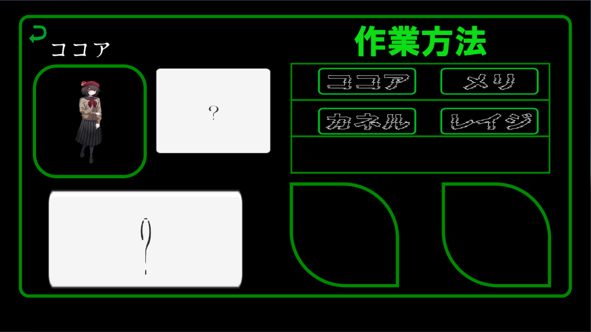</a>

- **載せたい情報の量に対して、場所が足りない**。今は文を入れられる枠が2〜4つしかない
- 「手に入れた情報」は**2周目以降も引き継ぐ予定**なので、遊ぶほど数が増えていく
- 「その他」「アイテム」のページを置く場所がない
- 見出しの「**作業方法**」は、連絡の行き違いで入った文。新しいレイアウトでは、この見出しはなくなる

---

## 3. 1キャラ分の資料に載せる情報

| 種類 | 中身 | 量 |
|---|---|---|
| 基礎情報 | 名前・年齢・職業・誕生日・身長・体重・特技・好きなもの・嫌いなもの | **9項目**（どれも短い）。ポイントで解禁する |
| 過去の情報 | ココアの例: 「大切なもの：家族」、幼少期（4行くらいの文）、現在（5行くらいの文） | **3項目以上**（これから増やす予定。長い文もある）。1つずつポイントで解禁する |
| 手に入れた情報 | 会話で知った情報（例:「メリのアリバイ」） | **遊ぶほど増える**（2周目以降も引き継ぐ） |

キャラごとのページとは別に、次の2つのページもあります。

- **その他**: キャラに関係しない情報（例:「事件当日は雨だった」）
- **アイテム**: キーアイテム（例:「現場の鍵」）

---

## 4. 描いてほしい画面

画像の文はココアの実際のデータです。「手に入れた情報」「その他」「アイテム」の文は、見た目を確かめるための**作り話の例**です。

### 4-1. キャラのページ（ココア・メリ・カネル・レイジ）

<a href="images/profile/profile_char.png">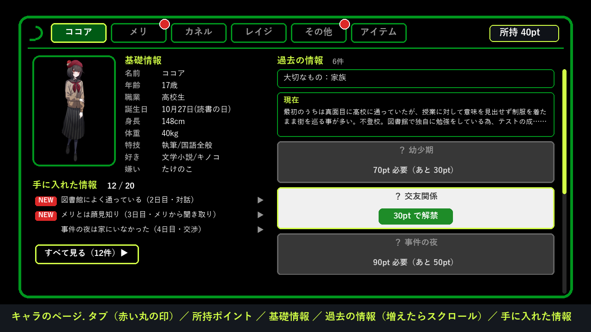</a>

画面にあるもの

- **上のタブ**: ココア・メリ・カネル・レイジ・その他・アイテム。タブの右上に**赤い丸の印**が付くことがある（新しい情報があるしるし）
- **所持ポイント**（右上。例:「所持 40pt」）
- **立ち絵**と**基礎情報**（左上）
  - 解禁する前は、名前と立ち絵だけ見えて、残りの8項目は「**？ 基礎情報**」の枠1つにまとめて隠れる
- **過去の情報**（右側）。見出しの横に件数（例:「6件」）
  - 解禁した枠: 見出しと文。長い文は2〜3行で切って、最後を「……」にする
  - 解禁前の枠: 「？ 見出し」と、**足りる**とき「◯pt で解禁」のボタン、**足りない**とき「◯pt 必要（あと◯pt）」
  - 数が多いときは、右の欄の中でスクロールする（右端にスクロールバー）
- **手に入れた情報**（左下）
  - 「12 / 20」（集めた数 / 全部の数）
  - 新しい3件だけを並べる。今回の周回で新しく手に入れたものに「**NEW**」の印。行の右端に「**▶**」
  - 「**すべて見る（12件）▶**」のボタン

### 4-2. 「手に入れた情報」の詳しい表示（窓）

手に入れた情報の行を押すと開く窓です。過去の情報の枠を押したときや、過去の情報を解禁した直後にも、同じ窓で全文を見せます。

<a href="images/profile/profile_char_detail.png">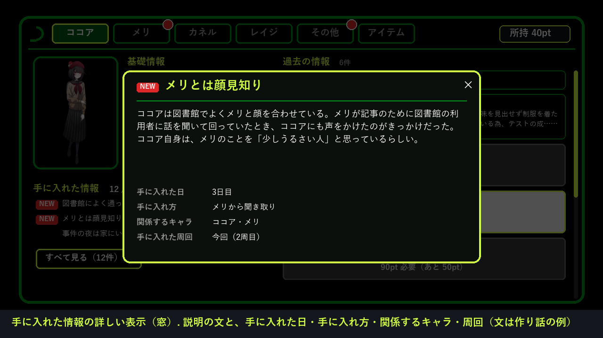</a>

<a href="images/profile/profile_char_unlock.png">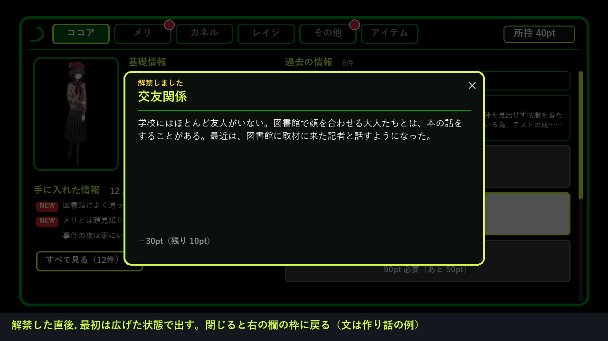</a>

- 上: 手に入れた情報の詳しい表示。見出し、NEW の印、説明の文、手に入れた日・手に入れ方・関係するキャラ・周回
- 下: 過去の情報を解禁した直後。「解禁しました」、見出し、文、使ったポイント
- 右上に「×」（閉じる）

### 4-3. 「手に入れた情報」の一覧（窓）

「すべて見る」を押すと開く窓です。

<a href="images/profile/profile_A2_list.png">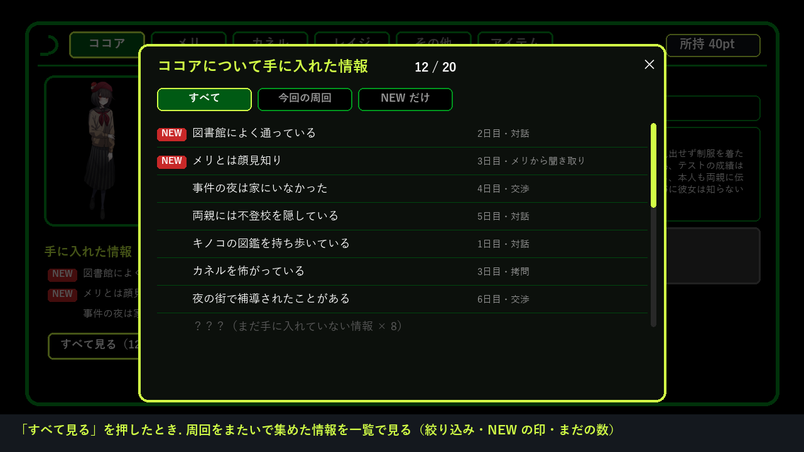</a>

- 見出し（例:「ココアについて手に入れた情報」）と「12 / 20」
- **小タブ**: 「すべて」「今回の周回」「NEW だけ」
- 一覧の行（NEW の印、見出し、手に入れた日と手に入れ方）
- まだ手に入れていない情報は「**？？？**」（数だけ。例:「？？？（まだ手に入れていない情報 × 8）」）
- 数が多いときはスクロールする

### 4-4. 「その他」のページ

<a href="images/profile/profile_other.png">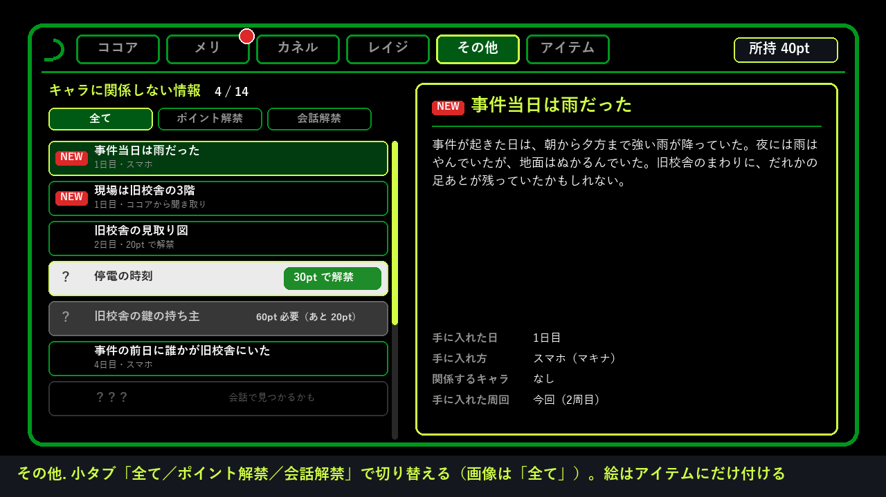</a>

- **左に一覧、右に選んだ情報の詳しい表示**
- 一覧の上に「キャラに関係しない情報」と「4 / 14」、**小タブ**「全て」「ポイント解禁」「会話解禁」
- 一覧の行は3種類
  1. 手に入れた情報。NEW の印が付くことがある。選んでいる行は色が変わる
  2. ポイントで解禁できる情報（**足りる**とき「◯pt で解禁」のボタン／**足りない**とき「◯pt 必要（あと◯pt）」）
  3. 会話で手に入る、まだの情報（「？？？」）
- 右の詳しい表示: 見出し、説明の文、手に入れた日・手に入れ方・関係するキャラ・周回

### 4-5. 「アイテム」のページ

<a href="images/profile/profile_item.png">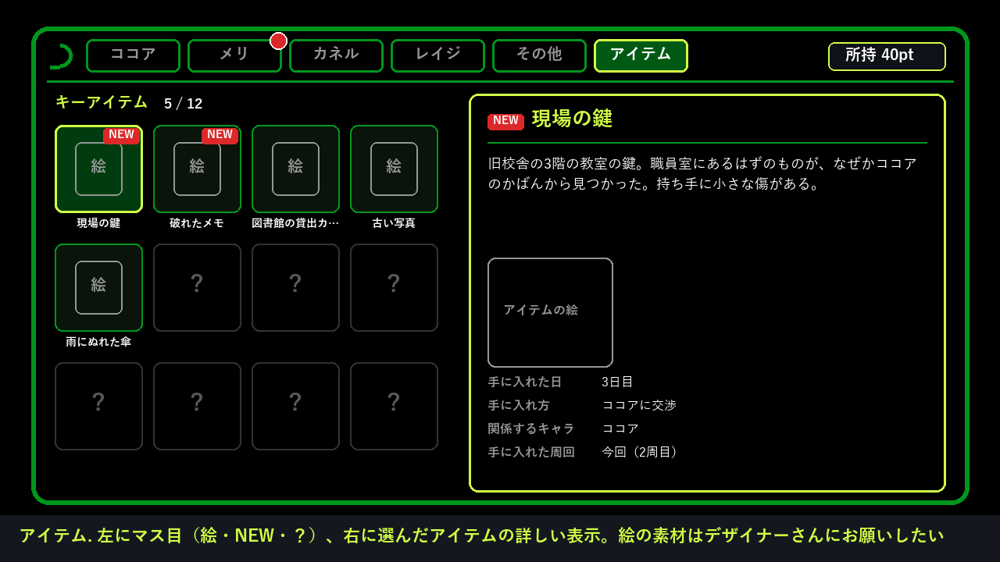</a>

- **左にマス目、右に選んだアイテムの詳しい表示**
- マス目: アイテムの**絵**と名前。まだ持っていないものは「？」。NEW の印が付くことがある。選んでいるマスは色が変わる
- 右の詳しい表示: 名前、説明の文、**大きい絵**、手に入れた日・手に入れ方・関係するキャラ・周回
- アイテムは見るだけ（「使う」操作はない）

---

## 5. 作ってほしい素材

「見本」は叩き台の画像から切り出したもので、**形や色の参考**です。自由に変えてください。

### 5-0. 素材の分け方

- **背景はページごとに1枚**にまとめる。外枠・区切り線・立ち絵の枠など、動かない部分をすべて入れる
- **文字は描き込まない**。ボタンや見出しの文、数字（「4 / 14」「30pt」など）は、ゲームの中でフォントを使って出す
  - 使いたいフォントと、状態ごとの文字の色（例:「選ばれている」は白、「足りない」は灰色）を決めてほしい
- **文字が入る土台は、伸び縮みできる外枠にする**
  - 画像を9つに分けて、**四隅（角）はそのまま、辺と真ん中だけを伸ばして**使う（Unity の「9スライス」という仕組み）。文字の長さや行の数が変わっても、1つの画像で足りる
  - 角の丸みや飾りは四隅に収め、辺と真ん中は伸ばしても崩れない模様（単色や、縦か横にそろった模様）にしてほしい
- **状態による見た目の違いは、ゲーム側で色を変えて出す**。差分の絵は描かなくてよい
  - 状態とは、例えば「選ばれている」（今開いているタブ、選んでいる行やマス）、「足りる／足りない」（解禁の枠）、「まだ」（「？？？」の行、持っていないアイテム）など
  - 外枠は**1種類だけ**、色を付けやすいように**白か明るい灰色**で作ってほしい
  - 状態ごとの**色**（外枠・中の塗り・文字）は決めてほしい（6章）
- それ以外に別の素材にするのは、上に重ねる印（タブの赤い丸、NEW など）と、アイテムの絵

<a href="images/profile/parts/nine_slice.png">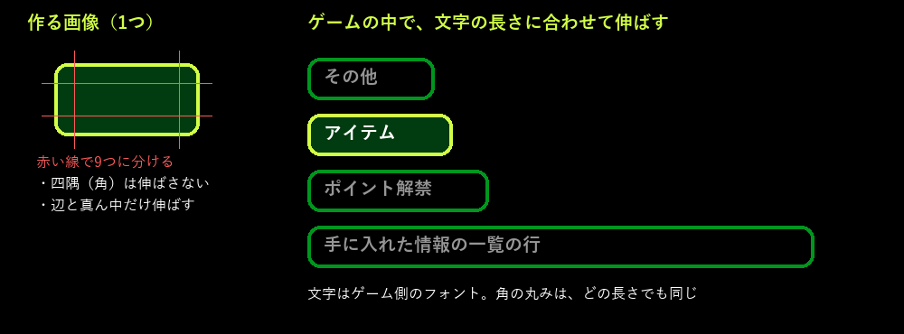</a>

**今ある素材を使うもの**（新しく作らなくてよい）

- 戻るボタン（今の緑の矢印）
- 上のタブのうち、キャラ4人（ココア・メリ・カネル・レイジ）。今ある名前プレートの画像を使う
- キャラの立ち絵（表情の差分も）

### 5-1. 背景（ページごとに1枚）

点線の部分は「ここに別の素材や文字が乗る」という目安で、背景には入りません。

| 背景 | 見本 | 背景に入れるもの |
|---|---|---|
| キャラのページ | <a href="images/profile/parts/bg_character.png">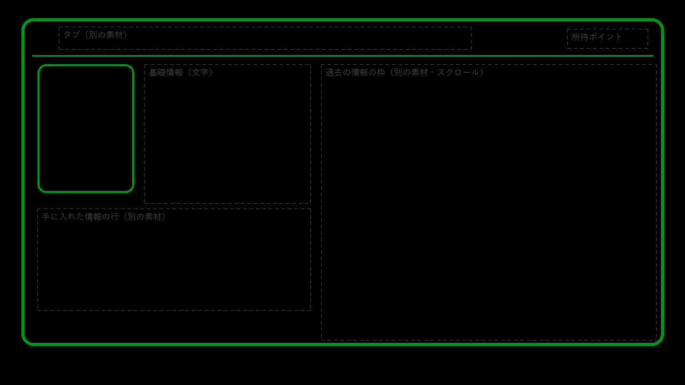</a> | 外枠、タブの下の区切り線、立ち絵の枠 |
| その他 | <a href="images/profile/parts/bg_other.png">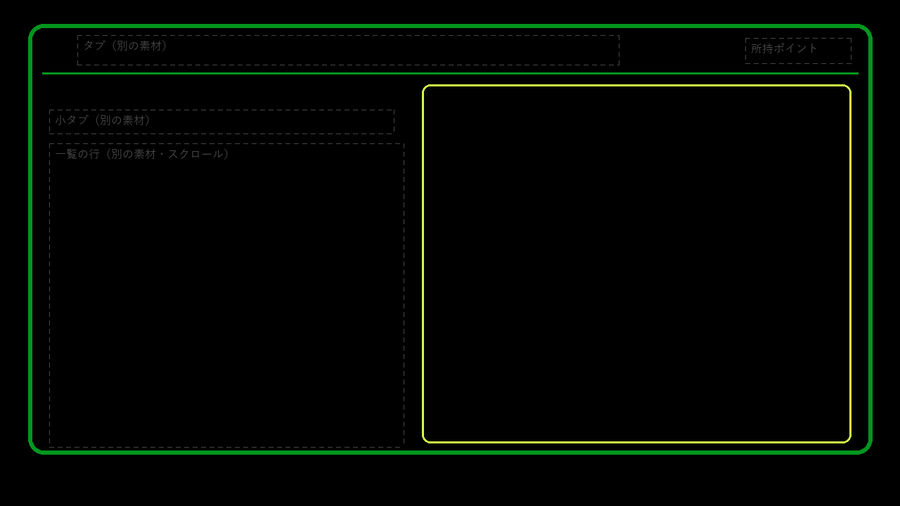</a> | 外枠、区切り線、右の詳しい表示の枠 |
| アイテム | <a href="images/profile/parts/bg_item.png">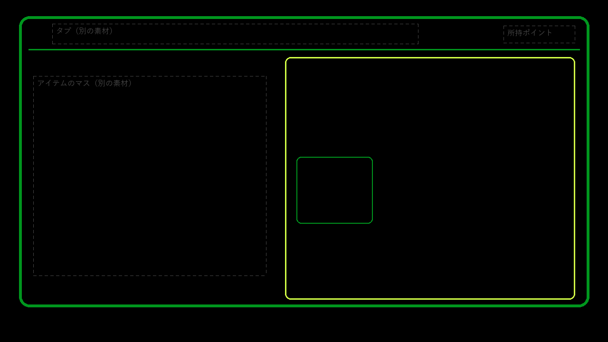</a> | 外枠、区切り線、右の詳しい表示の枠、大きい絵を置く枠 |
| 窓（4-2・4-3 で共通） | <a href="images/profile/parts/bg_popup.png">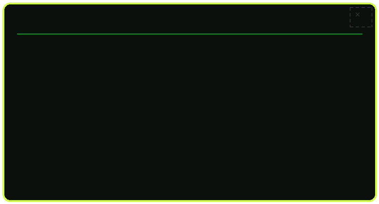</a> | 窓の枠、見出しの下の線。中身の量で大きさが変わるので、伸び縮みできる外枠にしてほしい |

### 5-2. 外枠（すべて伸び縮みできる外枠）

文字が入る土台は、ページをまたいで同じ外枠を使い回します。各外枠は**1種類だけ**作ってください。見本の色の違い（選ばれている、足りない、など）は、ゲーム側で色を変えて出します。

| 外枠 | 見本 | 使う場所 |
|---|---|---|
| ① 角の丸い外枠 |     | 上のタブ（その他・アイテム）、小タブ、「すべて見る」ボタン、所持ポイントの枠 |
| ② 解禁ボタン |  | 「◯pt で解禁」ボタン。枠ではなく、中まで塗りつぶしたボタン |
| ③ 情報の枠 |   <a href="images/profile/parts/past_lock_ok.png">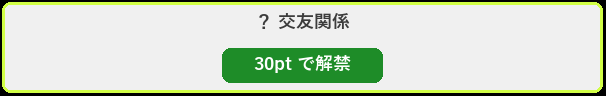</a>  | 過去の情報、基礎情報の「？」、手に入れた情報の行、一覧の行、その他の一覧の行。高さは中身で変わる |

### 5-3. 印・小物（伸び縮みしない）

| 部品 | 見本 | 使う場所 |
|---|---|---|
| タブの赤い丸 |  | タブの右上に重ねる |
| NEW の印 |  | 一覧の行やアイテムのマスに重ねる |
| スクロールバー |  | 過去の情報の欄、一覧。溝とつまみ（黄緑の部分）の2つ |

### 5-4. アイテムのページだけで使うもの

| 部品 | 見本 | メモ |
|---|---|---|
| アイテムのマス | <a href="images/profile/parts/item_cell.png">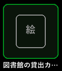</a> | 大きさは固定。1種類だけ。「選ばれている」「持っていない（？）」はゲーム側で色を変えて出す |
| **アイテムの絵** | <a href="images/profile/parts/item_picture.png">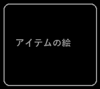</a> | **アイテムの数だけ**。マス用の小さい絵と、詳しい表示用の大きい絵（同じ絵を縮めて使ってもよい）。アイテムの一覧はまだ決まっていない（決まり次第お伝えします） |

---

## 6. 決めてほしいこと・確認したいこと

1. 4章の5つの画面の、細かい配置と見た目
2. 使いたいフォント
3. 状態ごとの色（外枠・中の塗り・文字）。決めてほしい状態は次のとおり
   - ふつう／選ばれている（タブ、その他の一覧の行、アイテムのマス）
   - 足りる／足りない（解禁前の枠）
   - まだ（「？？？」の行、持っていないアイテム）
4. キャラ4人のタブは今ある名前プレート（文字が画像に描き込まれている）を使い、その他・アイテムのタブはフォントで文字を出すので、**見た目がそろわないかもしれない**。そろえ方を相談したい（例: 名前プレートの文字に近いフォントを使う、キャラ4人もフォントにする）
5. 5章の素材を作ってもらえるか。特に**アイテムの絵**（数はアイテムの一覧が決まり次第お伝えします）

わからないことがあれば、いつでも聞いてください。
