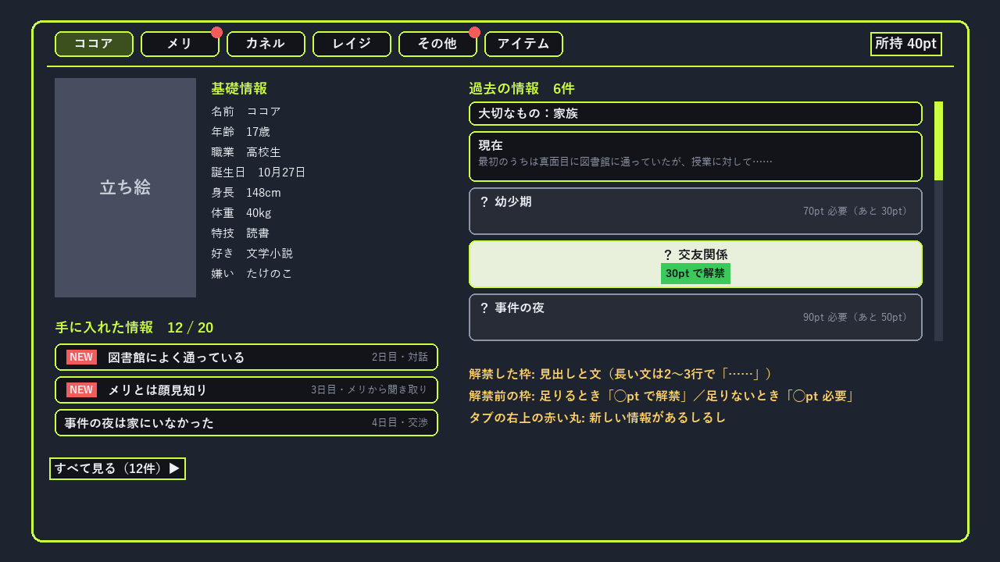
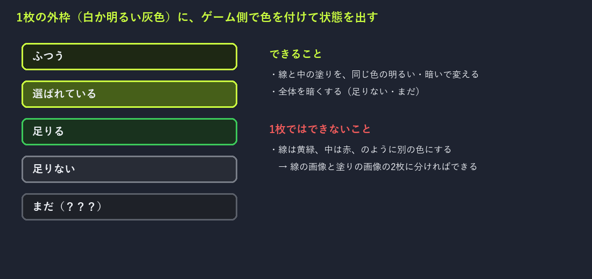

# 資料画面の動き（プログラム側）

最終更新: 2026-10-17

資料画面を新しいレイアウトにするときに、**プログラム側で作る動きと見た目の調整**をまとめたメモです。
デザイナーさんにお願いする見た目と素材は `Docs/資料画面のデザイン相談.md` にあります。決まったことは `Docs/仕様書.md` の3番・17番にも書いています。

---

## 1. 開いたとき

- 取調室の「資料」から開いたときは、**その部屋のキャラのタブ**を出す
- モニター（机のノート）から開いたときは、**前に見ていたタブ**を出す

## 2. タブの赤い丸（新しい情報の印）

- そのタブに、**まだ見ていない新しい情報**があるときだけ出す。キャラのページなら「手に入れた情報」、その他・アイテムならそのページの中身が対象
- そのタブを開いたら消す
- 資料画面の中だけ。**モニターの資料ボタンには何も出さない**（U3・U7: 見なければ損だと思わせない）

## 3. キャラのページ

### 基礎情報

- 解禁する前は、名前と立ち絵だけ見せる。残りの8項目は「？ 基礎情報」の枠1つにまとめて隠す

### 過去の情報

- 解禁する前も**見出しを見せる**（例:「？ 幼少期　70pt」）。どれを先に解禁するか選べるように
  - 今のデータ（ProfileDataSO の historyInfoList）は、見出しが文の頭に入っている（例:「幼少期：両親が……」）。`itemName`（今は解禁の確認で出す名前）を見出しとして使い、文から見出しを外す
- 見出しの横に件数（例:「6件」）を出す。数が多いときは右の欄の中でスクロールする
- **過去の情報は全部並べる**。今は画面の置き場所の都合で3番目（PAST_3）だけ表示しているが、新しいレイアウトではこの制限をなくす
- 解禁した枠は、長い文を2〜3行で切って、最後を「……」にする
- **マウスを乗せると外枠の色を変える**（「広げる」の印は付けない）。押すと窓で全文を見せる
- **解禁した直後は、窓で全文を広げて出す**。一度広がるのを見れば、「この枠は押すと広がる」と遊びながら覚えてもらえる
- ポイントが足りるときは「◯pt で解禁」のボタン（押すと今の確認ダイアログを出す）、足りないときは「◯pt 必要（あと◯pt）」と出す（U7）

### 手に入れた情報

- 新しい3件だけを並べ、「12 / 20」（集めた数 / そのキャラの情報の全部の数）と「すべて見る」を出す
  - 全部の数は、フラグ一覧のシートでそのキャラのページに出す情報の数。何周遊んでも、これより多くはならない
- 今回の周回で初めて手に入れた情報に「NEW」の印
- **行全体を押せる**ようにする（「▶」は押せることを知らせる印。押せる範囲は行全体）。**マウスを乗せると行全体を光らせる**
- 押すと窓で、説明の文と「手に入れた日・手に入れ方・関係するキャラ・周回」を見せる

- 過去の情報の枠・手に入れた情報の行は、マウスを乗せると外枠（行は行全体）の色を明るくする。色はデザイナーさんの決めた色に合わせる

## 4. 「すべて見る」の一覧（窓）

- 小タブ「すべて」「今回の周回」「NEW だけ」で絞り込む
- まだ手に入れていない情報は「？？？」として数だけ出す

## 5. 「その他」のページ

- 一覧の行を押すと、右側に詳しい表示を出す（窓は使わない）
- 小タブ「全て」「ポイント解禁」「会話解禁」で絞り込む
- 会話で手に入る情報は、まだのときは「？？？」（見出しも出さない）。ポイントで解禁する情報は、まだのときも見出しを出す
- 1つの情報は、会話かポイントの**どちらか片方だけ**で手に入る

## 6. 「アイテム」のページ

- マスを押すと、右側に詳しい表示を出す
- 見るだけ（「使う」操作はない）

---

## 7. 見た目の調整（デザイナーさんの素材をもとに、プログラム側でやること）

- **マウスを乗せたときの見た目**: Unity の Button の「Transition」（Color Tint など）で明るさや色を変える。デザイナーさんには「乗せた」状態の画像を頼まない
- **伸び縮みできる外枠**: もらった画像を Sprite Editor で「Border」（9スライスの区切り）を設定し、Image の「Image Type」を「Sliced」にして使う
- **状態の見た目**: デザイナーさんには外枠を1種類（白か明るい灰色）だけ描いてもらい、状態はすべて Image の Color で色を変えて出す。差分の絵は頼まない
  - ふつう／選ばれている（タブ、その他の一覧の行、アイテムのマス）
  - 足りる／足りない（解禁前の枠）
  - まだ（「？？？」の行、持っていないアイテム）
  - 色はデザイナーさんに決めてもらう
- 過去の情報（解禁した・解禁前）、基礎情報の「？」、手に入れた情報の行、一覧の行、その他の行（3種類）は、**同じ1つの外枠**を色と中身だけ変えて使う
- **文字**: TextMeshPro で出す。状態ごとの文字の色はデザイナーさんに決めてもらう
- **「▶」の印**（手に入れた情報の行の右端）と **×（窓を閉じるボタン）** は、絵ではなくフォントの文字で出す。TextMeshPro のフォント素材に「▶」「×」を含めておく
- **タブの赤い丸**と **NEW の印**は、デザイナーさんに描いてもらう絵を使う

### 外枠の使い分け

デザイナーさんには外枠を3種類（デザイン相談 MD の 5-2）だけ描いてもらい、ゲーム側で次のように使い分ける。

| 外枠 | 使う場所 | ゲーム側でやること |
|---|---|---|
| ① 角の丸い外枠 | 上のタブ（その他・アイテム） | 文字の長さに合わせて横に伸ばす。「選ばれている」は色を変える |
| | 「すべて見る」の一覧の小タブ（すべて・今回の周回・NEW だけ） | 同上 |
| | その他の小タブ（全て・ポイント解禁・会話解禁） | 同上 |
| | 「すべて見る」ボタン | 文字の長さに合わせて伸ばす |
| | 所持ポイントの枠 | 数字の桁に合わせて伸ばす |
| ② 解禁ボタン | 基礎情報の「？」、過去の情報（解禁前）、その他のポイント解禁の行の中の「◯pt で解禁」 | ポイントが足りないときはボタンを出さず、「◯pt 必要（あと◯pt）」の文字にする |
| ③ 情報の枠 | 過去の情報（解禁した） | 高さを文の行数に合わせる。マウスを乗せたら色を変える |
| | 過去の情報（解禁前）、基礎情報の「？」 | 足りる／足りないで色を変える |
| | 手に入れた情報の行、「すべて見る」の一覧の行 | マウスを乗せたら色を変える |
| | その他の一覧の行（手に入れた・ポイントで解禁・「？？？」） | 選ばれている／足りる／足りない／まだ、で色を変える |
| | アイテムのマス | 外枠は別（デザイン相談 MD の 5-4）。選ばれている／持っていないで色を変える |

- 色の付け方（Image の Color）は画像全体に掛かる。そのため1枚の画像だと、**線と中の塗りは「同じ色の明るい・暗い」にしかできない**
  - 「線は黄緑、中は暗い黄緑」のような見た目なら、1枚（白い線＋中は暗い灰色か透明）で足りる。叩き台の見た目はほぼこれで出せる
  - 「線は黄緑、中は赤」のように**別の色**にしたいときだけ、線の画像と塗りの画像の2枚に分けて重ねる。デザイナーさんの決めた色を見てから判断する

- **名前プレートのタブ**（文字が画像に描き込まれている）の「選ばれている」は、ゲーム側で明るさや大きさを変えて出す

## 8. データと記録

### Excel（フラグ一覧のシート）

| 列 | 今 | 資料画面での使い道 |
|---|---|---|
| 種類（キーアイテム／情報／進行フラグ） | **ある** | キーアイテムはアイテムのページ、情報はキャラのページかその他のページ |
| 表示先（A〜D／その他／アイテム／なし） | **ある** | どのページに出すか。キャラのページの「12 / 20」の全部の数も、この列で数える |
| プロフィールに表示する文 | **ある** | 詳しい表示の文 |
| 説明 | **ある** | 作る人向けのメモ（画面には出さない） |
| 見出し | **足す** | 一覧や窓に出す名前（例:「メリとは顔見知り」）。フラグ名（例: `info_メリのアリバイ`）は画面に出さない |
| 解禁ポイント | **足す** | 空なら会話で手に入る情報、数字があればそのポイントで解禁する情報（1つの情報はどちらか片方だけ） |
| 関係するキャラ | **足す** | 詳しい表示の「関係するキャラ」（例: B, D）。いらなければ表示しない |
| 画像 | **足す** | アイテムの絵（キーアイテムだけ。素材の名前の決め方は仕様書10番と同じ） |

### 新しく作る記録

- 手に入れた情報ごとに、**手に入れた日・手に入れ方・周回**を記録する（今は記録していない）
  - 手に入れ方は「◯◯に対話」「◯◯から聞き取り」「スマホ」「◯pt で解禁」のように、手に入れたときの行動から作る
- **周回をまたいで残る記録**を作る（2周目以降も手に入れた情報を引き継ぐため）。既読の記録（ReadHistoryStore）やエンディングの記録（EndingRecordStore）と同じように、セーブデータとは別のファイルにする
- 「NEW」と「タブの赤い丸」のために、**見たかどうか**も記録する

---

## 9. 新しく作るものの一覧

| No. | 作るもの | くわしく |
|---|---|---|
| 1 | 資料画面を上のタブの形に作り直す（キャラ4人・その他・アイテム） | 1章、デザイン相談 MD |
| 2 | 開いたときのタブの選び方 | 1章 |
| 3 | タブの赤い丸（新しい情報の印） | 2章 |
| 4 | 所持ポイントの表示（U7） | デザイン相談 MD の 4-1 |
| 5 | 基礎情報の解禁前の表示（名前と立ち絵だけ） | 3章 |
| 6 | 過去の情報: 見出しの表示、件数、スクロール、2〜3行で切る、解禁の枠の足りる／足りない（U7）、マウスを乗せたときの色、押すと窓で全文、解禁した直後に窓で全文 | 3章 |
| 7 | 過去の情報の見出しのデータ（`itemName` を見出しにして、文から見出しを外す） | 3章 |
| 8 | 手に入れた情報: 新しい3件、「12 / 20」、NEW、行を押すと詳しい表示の窓 | 3章 |
| 9 | 「すべて見る」の一覧の窓（小タブで絞り込み、「？？？」の数） | 4章 |
| 10 | その他のページ（小タブ、ポイントで解禁する情報、右の詳しい表示） | 5章 |
| 11 | アイテムのページ（マス目、絵、右の詳しい表示） | 6章 |
| 12 | 外枠の使い分けと色の付け方（9スライス、状態ごとの色）、フォントに「▶」「×」を入れる | 7章 |
| 13 | フラグ一覧のシートに列を足す（見出し・解禁ポイント・関係するキャラ・画像）。取り込みのチェックも足す | 8章 |
| 14 | 手に入れた日・手に入れ方・周回の記録、周回をまたぐ記録、見たかどうかの記録 | 8章 |
| 15 | 自動テスト（解禁、タブの印、周回をまたぐ記録など） | — |
